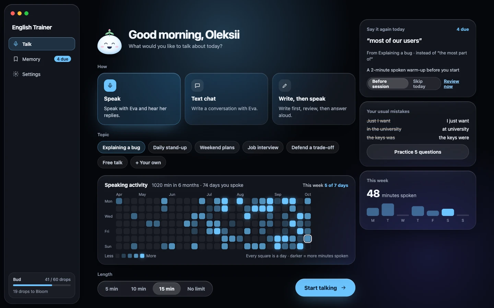
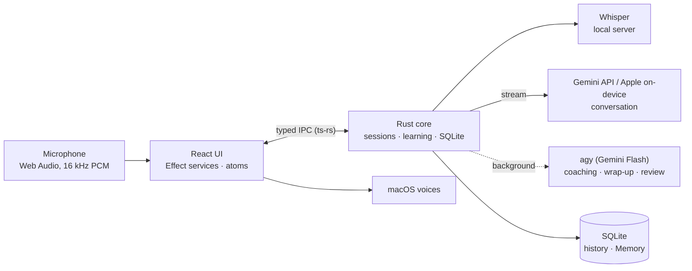

# English Trainer

Practise **speaking** English with Eva, an AI partner on your Mac that answers in about two seconds,
helps you structure an answer while you speak, and brings back the phrases worth remembering.

macOS · Apple Silicon · local speech recognition · your history never leaves the Mac



## Features

- **Talk** — a voice conversation: push-to-talk or hands-free, Eva starts speaking while her reply is
  still being generated, and you can interrupt her
- **Inline coaching** — "More natural: …" and one focus point under each answer, without ever
  delaying the conversation; say it again and see what changed
- **Help while speaking** — a frame, phrases and a model answer prepared before you start, plus a
  "stuck" rescue and missing-word finder in the middle of an answer
- **Learning Memory** — phrases and recurring mistakes return as short spoken tasks and as targets in
  later conversations; status changes only on real, unprompted use
- **Write, then speak**, text chat, practice of your usual mistakes, and on-device word translation
- **Private by default** — Whisper runs locally and raw audio is discarded; only the transcript goes
  to the AI provider

## How it works



The reply streams to the UI and is spoken sentence by sentence; coaching, help and wrap-up run in
parallel and never block the next turn.

## Run it locally

Requires Bun, Rust, Xcode Command Line Tools and `brew install whisper.cpp`.

```bash
bun install
bun run dev
```

Speech model, AI keys, checks and building the installer: [`docs/SETUP.md`](docs/SETUP.md).

## Documentation

| | |
| :--- | :--- |
| [Product](docs/PRODUCT_SPEC.md) · [Roadmap](docs/ROADMAP.md) · [Design](docs/DESIGN.md) | what it does, what is next, how it looks |
| [Architecture](docs/ARCHITECTURE.md) · [Technical requirements](docs/TECHNICAL_REQUIREMENTS.md) | runtime structure and contracts |
| [Code requirements](CODE_REQUIREMENTS.md) · [`docs/engineering/`](docs/engineering) | how code is written: layers, Effect, Rust, tests |
| [AGENTS.md](AGENTS.md) | entry point for AI coding agents |

## License

[AGPL-3.0-or-later](LICENSE).
