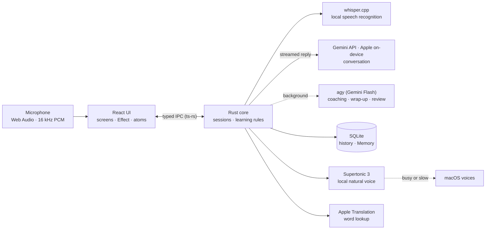

# English Trainer

Practise **speaking** English with Eva, an AI partner on your Mac that answers in about two seconds,
helps you structure an answer and brings back the phrases worth remembering.

macOS · Apple Silicon · local speech recognition · your history never leaves the Mac


## Features

- **Talk** — a voice conversation, push-to-talk or hands-free; Eva answers in a natural local voice
  while the reply is still streaming, and you can interrupt her
- **Help while speaking** — a frame, phrases and a model answer before you start, and a "Stuck"
  rescue in the middle of an answer
- **Review after the conversation** — every answer gets a more natural version and one reason on the
  wrap-up; the conversation never waits for it
- **Learning Memory** — saved phrases and recurring mistakes come back as a spoken review, a
  warm-up and a practice of your usual mistakes
- **Write, then speak**, text chat and on-device translation of a selected word or phrase
- **Eva grows** from a seed to full bloom as you speak, and the Dock icon grows with her
- **Private by default** — Whisper runs locally and raw audio is discarded; only the transcript goes
  to the AI provider

What each feature does and how it works: [FEATURES.md](FEATURES.md).

## How it works



The reply streams to the UI and is spoken sentence by sentence; coaching, help and the wrap-up run
in parallel and never block the next turn. Details: [ARCHITECTURE](docs/ARCHITECTURE.md).

## Run it locally

Requires Bun, Rust, Xcode Command Line Tools and `brew install whisper.cpp`.

```bash
bun install
bun run dev
```

Speech model, AI keys, checks and building the app: [`docs/SETUP.md`](docs/SETUP.md).

## Documentation

| | |
| :--- | :--- |
| [Features](FEATURES.md) · [Product](docs/PRODUCT_SPEC.md) · [Roadmap](docs/ROADMAP.md) · [Design](docs/DESIGN.md) | what is built, what it does, what is next, how it looks |
| [Architecture](docs/ARCHITECTURE.md) · [Technical requirements](docs/TECHNICAL_REQUIREMENTS.md) | runtime structure and contracts |
| [Code requirements](CODE_REQUIREMENTS.md) · [`docs/engineering/`](docs/engineering) | how code is written: layers, Effect, Rust, tests |
| [Contributing](CONTRIBUTING.md) · [AGENTS.md](AGENTS.md) | issue → PR workflow; entry point for AI coding agents |

## License

[AGPL-3.0-or-later](LICENSE).
