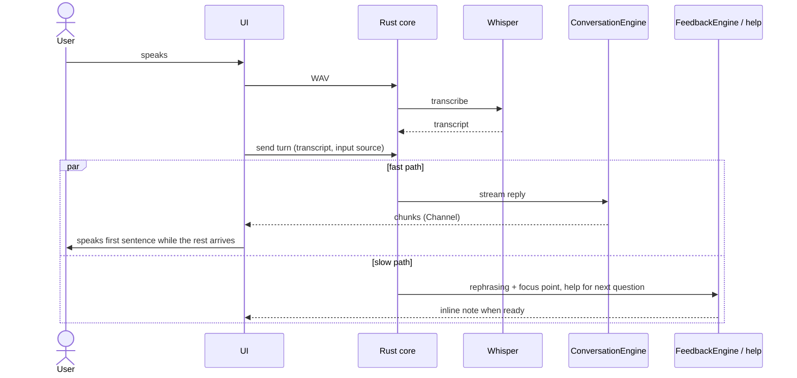

# Architecture

How the running system is shaped. Numbers, limits and error codes live in
[TECHNICAL_REQUIREMENTS.md](TECHNICAL_REQUIREMENTS.md) (TR); behaviour in
[PRODUCT_SPEC.md](PRODUCT_SPEC.md).

## 1. Goals

1. **Low perceived latency:** end of learner speech to first AI audio under 2.5 s (p50).
2. **Conversation never waits for evaluation:** coaching, help and wrap-up run in parallel.
3. **Local first:** speech recognition, history and Learning Memory stay on the Mac.
4. **Replaceable providers:** product logic depends on engine traits, not on a model or CLI.

## 2. Overview

```text
┌──────────────────────── React UI (Tauri WebView) ────────────────────────┐
│ Talk screen · Learning Memory · Settings                                  │
│ Web Audio capture (PCM 16 kHz) · speech playback queue · visuals          │
└───────────────┬──────────────────────────────────────────▲───────────────┘
                │ invoke() (typed)                         │ Channel (streamed chunks)
┌───────────────▼──────────────────────────────────────────┴───────────────┐
│ Rust core                                                                 │
│ conversation/  session orchestration, coaching queue, help, recall        │
│ learning/      normalisation, scheduling, usage and mastery rules         │
│ persistence/   SQLite (single connection behind a mutex)                  │
│ audio/         WAV validation, local Whisper                              │
│ voice/         local natural voice (Supertonic 3 helper)                  │
│ providers/     conversation engines, batch coaching, UsageReviewEngine    │
│ translation/   on-device word lookup and bundled helper control           │
│ setup/         diagnostics for local dependencies                         │
└───────┬───────────────────────────┬──────────────────────────────────────┘
        │                           │
  Local helpers               Conversation / evaluation providers
  whisper.cpp · Supertonic 3  Apple Foundation Models helper · Gemini API · agy
```

## 3. Frontend and Rust split

- React/TypeScript owns UI, audio capture and playback controls. Rust owns sessions, providers,
  persistence, metrics and learning decisions. IPC is typed (TR §10).
- Routes: `/` (home), `/conversation` (the one Talk screen), `/memory`, `/settings`, `/summary`.
- Frontend layers, state and migration rules: [engineering/FRONTEND.md](engineering/FRONTEND.md) and
  [engineering/MIGRATION.md](engineering/MIGRATION.md). Backend conventions:
  [engineering/BACKEND.md](engineering/BACKEND.md).
- UI lifecycle states (capture, practice) are discriminated unions.

## 4. Audio, speech recognition and speech output

```text
record (AudioWorklet, mono PCM, 16 kHz, browser voice processing off)
  → WAV in memory → invoke(raw bytes) → validate WAV
  → POST to the whisper-server child (model kept loaded) → JSON → transcript
    (fallback: temp dir → whisper-cli → JSON → transcript → delete temp dir)
```

- One warm microphone session stays open while a practice session is active. Warm-up happens once
  at open, not per answer; a short pre-roll keeps the first syllable. Energy-based turn detection
  ends a turn after a pause.
- The `whisper-server` child (Rust `audio` module) holds the model: one per app run, bound to
  127.0.0.1, started when a session or unfinished Memory review opens or on the first answer,
  restarted once if it dies, stopped on exit (a pid note cleans up after a crash). It is the only
  long-lived process on the speech path; the UI never talks to it. Restart and fallback rules: TR §3.
- Rust builds the initial prompt (question, recent names, glossary).
- While an answer is recorded, a live transcript re-runs the loaded model on the audio so far. It is
  presentation only; only the final transcript is scored. The same ticker serves Talk and the spoken
  Memory review recorders and never opens a second microphone.
- Raw audio exists only in memory and a temporary directory and is deleted after transcription,
  unless the learner opts in to keeping it (TR §8).
- Speech output: the `voice` context owns one persistent bundled Supertonic 3 helper behind the
  `SpeechEngine` port, prewarmed outside the conversation queue, returning trimmed PCM WAV over
  typed binary IPC; its process lifecycle stays in Rust. `core/speech` (Effect services, `Stream`,
  `Scope`) turns the reply text stream into audio: it renders phrases ahead of playback, schedules
  them on one Web Audio clock and falls back to macOS system voices for the rest of a stream when
  the engine is busy, slow or unavailable. Interrupting closes the scope. Limits and timings: TR §4.

## 5. Conversation vs evaluation



- The reply streams from `send_practice_turn`; the UI queues completed sentences to the speech facade
  independently of coaching.
- Each saved answer joins a per-session coaching queue in Rust. Batches of up to five answers run in
  the background through `agy`; notes appear under the answers when a batch lands (`coaching-updated`
  event). The UI re-reads on events and never polls.
- A turn cancellation token is owned by Rust and checked atomically before saving; the UI also
  invalidates late stream and speech callbacks. Voice interruption is opt-in and gated by actual
  echo cancellation.
- Help (answer plan, stuck rescue), session wrap-up and review material are separate background
  calls. None holds the session lock, and none blocks answering.

## 6. Providers

| Engine | Purpose | Adapters |
| :--- | :--- | :--- |
| `ConversationEngine` (tier: conversation) | Short spoken reply + one question | Gemini API (HTTPS streaming, default) raced against the Apple helper as backup; Apple helper (one long-lived process, `prewarm()`); `agy` (legacy: process per turn) |
| Batch coaching (tier: coaching) | Rephrasing and one focus point per answer, up to five answers per call | `agy`, `gemini-3.8-flash-medium`. The Gemini API is not used (its free quota is reserved for conversation) |
| Answer planner | Frame, phrases and hidden example for the current question | Gemini API, question-only prefetch; `agy` guided-answer IPC remains for compatibility |
| `RescueEngine` | Next step, simpler wording or missing-word candidates during recording | `agy`, `gemini-3.8-flash-high` |
| `SessionWrapupEngine` | Zero to three phrases from a finished session | `agy`, `gemini-3.8-flash-high` |
| `ReviewMaterialEngine` | One situation and model sentence per due review item | `agy`, `gemini-3.8-flash-high` |
| Mistake-practice planner | Five questions from recurring mistakes | `agy`, background tier |
| `UsageReviewEngine` | Semantic check of phrase use (frozen subsystem) | `agy` (Gemini API when touched) |
| Word lookup | Native-language word + English explanation | Bundled one-shot Swift helper `apple-translation` (macOS Translation + local Foundation Models) |

Rules:

- Call sites choose a **tier**, not a model ID. Every `agy` call names a Gemini model;
  `CliOptions.model` is mandatory and a test runs each entry point against a fake CLI.
- Provider output is parsed into typed Rust values; invalid output is a recoverable typed error.
- Only transcript and minimum prompt context leave the Mac. API keys live in an encrypted,
  owner-only file in the app data folder, never in SQLite or logs.
- `agy` runs only in a private temporary directory, never in the repository.
- The word-lookup helper never uses the conversation helper's queue, Gemini or `agy`. Rust owns the
  language preference, validation, concurrency guard and process lifetime. React offers lookup only
  on explicit action within marked English content.

## 7. Learning engine

- Mistakes and phrase cards with review events and a simple interval schedule. Mistake observations
  are stored at once; Memory and due surfaces need two distinct observations.
- Due items enter conversation context on selected turns (at most two targets).
- Spoken recall (daily recall, Memory review) records transcript evidence and updates the schedule
  atomically.
- Input source (`voice`, `edited`, `text`) and cue exposure (help shown) are stored, so cued or typed
  answers never count as independent spoken evidence.
- An explicit usage review may assess the first two conversation answers against prior targets and
  maintain a multi-week mastery streak. This subsystem is frozen (TR §9.2).
- Session variants share one session model: topic and time goal with an active-time clock kept in
  Rust, write-then-speak phases, and a five-question mistake-practice plan. Rust validates phase
  transitions. Rehearsal and mistake practice are cued, so they never become independent-use
  evidence. Rules: TR §7.
- Session finish commits a durable wrap-up job. A `WrapupQueue` resumes pending jobs at startup and
  calls the engine outside the session mutex; results or typed failures persist before events
  refresh the UI. Review material has its own SQLite cache so background generation cannot delay
  first-answer scoring.

## 8. Persistence

SQLite in the app data directory, one connection behind `Arc<Mutex<_>>`, migrations in the
persistence schema module. Provider calls run on blocking worker threads and never hold the lock.
Tables: TR §8. UI-only conveniences (microphone device, flow preferences, Dock icon) live in WebView
storage.

## 9. Failure handling

- STT failure: the recording stays in memory for retry until reset; the session is untouched.
- Provider failure or timeout: the answer stays editable and can be resent; nothing is saved for the
  failed turn.
- Coaching, help or wrap-up failure: the conversation continues; failures are visible with retry.
- Missing dependency (Whisper, model, Apple model, API key): Settings shows the status and a
  recovery step; no crash.

## 10. Non-goals for the MVP

Screen or active-app monitoring, cloud speech recognition, a native Swift rewrite, menu-bar and
notification surfaces, WidgetKit, phoneme-level pronunciation scoring, multi-user features.

