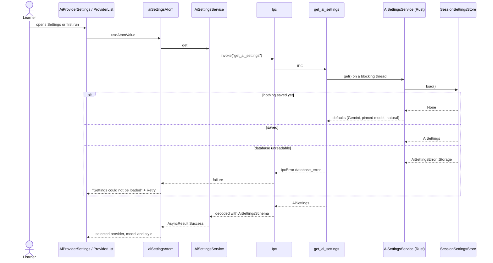
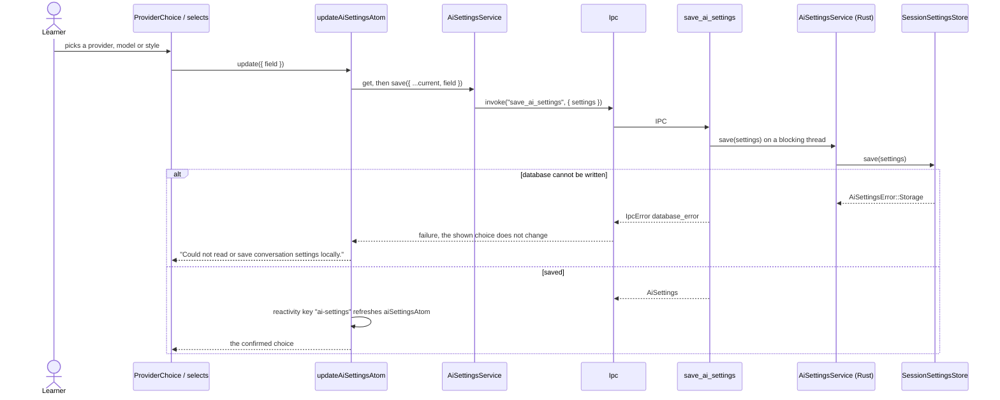
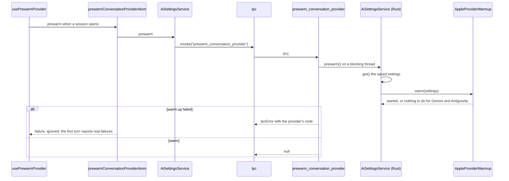
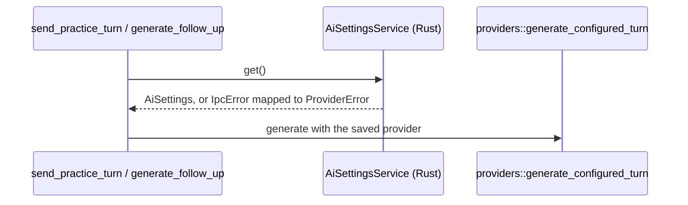

# AI settings flow

The saved conversation provider, Antigravity model and Eva's style. Read by Settings
(`AiProviderSettings`), first run (`ProviderList`) and Talk (`useConversationProvider`,
`usePrewarmProvider`). The Gemini API key never travels here: it has its own feature,
`gemini-key`.

## Read the settings

## Change one setting

## Warm the provider

## A turn reads the settings

