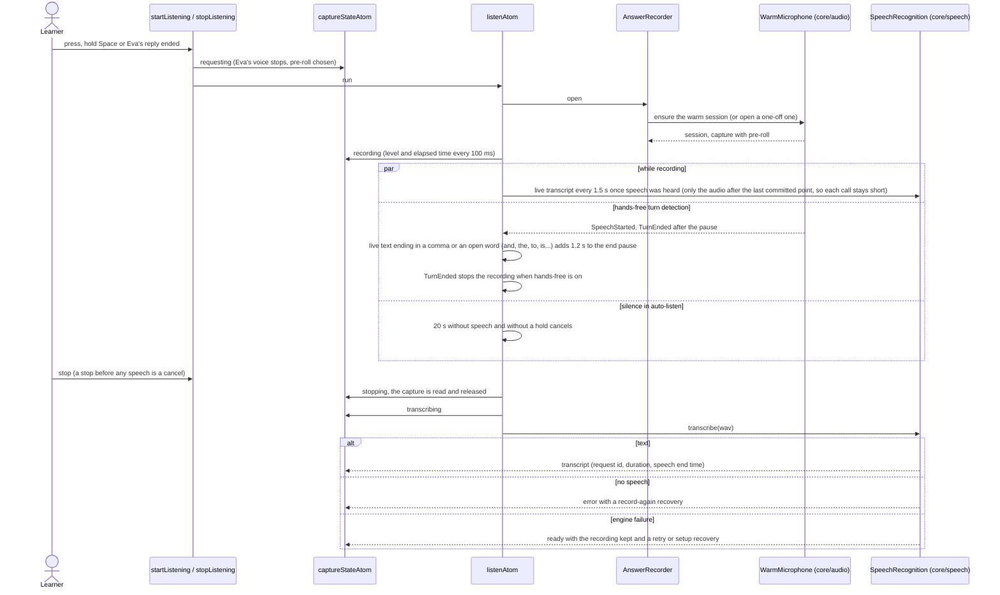

# Answer capture

One spoken answer, from the learner pressing the microphone (or Space, or Eva finishing) to a
transcript. It composes `core/audio` (the warm microphone, the capture, the turn detector) and
`core/speech` (Whisper and the live transcript); it knows nothing about sessions or replies.

## Record, stop, transcribe

## Cancel, reset, rescue

`cancelListening` interrupts `listenAtom`, which closes the capture scope and releases the
microphone. `resetCapture` does the same and forgets a kept recording. `holdForRescue` keeps the
turn open while the Stuck panel is working (`turnHeldOpenAtom` feeds the detector's hold), and
`rescueTranscriptAtom` transcribes the last 15 seconds of the live capture for it. A device lost
during a recording ends it with a microphone error.
