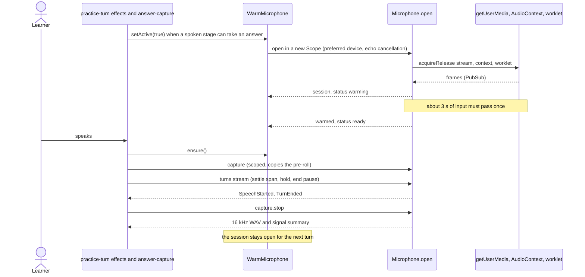
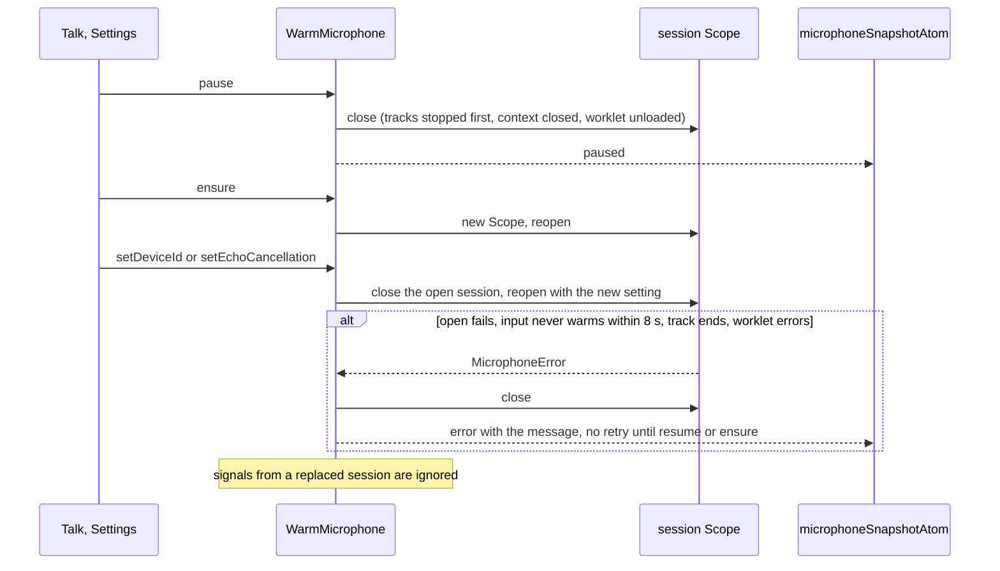
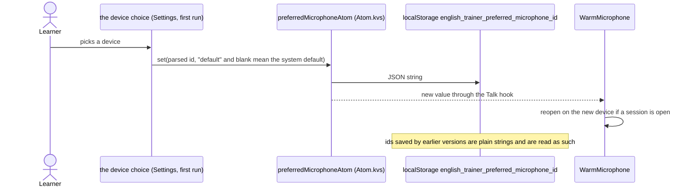
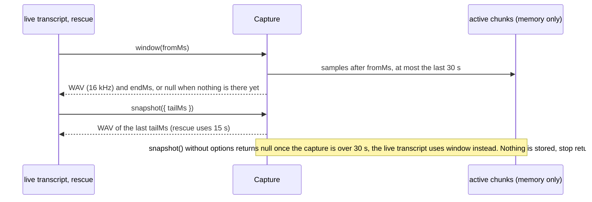

# Core audio

The microphone for practice and for one-off recordings: the warm session that stays open between
turns, PCM capture with pre-roll, turn detection and the remembered input device. Raw audio lives
in memory only; it is released when a capture's scope closes or after transcription. Whisper and
the live transcript are not here (they move with `core/speech`, #49).

Services (all in `services/`): `Microphone` opens one stream as a scoped resource, `WarmMicrophone`
owns the warm session between turns, `AudioInputsService` lists devices. `ClipRecorder` records one-off clips for Settings and
first run. `core/answer-capture` is the practice-side user of the warm session.

## Warm session for practice



The end pause is `endPauseMs` plus an extra pause the caller sets while the live text ends in an
unfinished clause. Once speech is confirmed the noise floor can only fall, and a frame counts as
silence only below a lower keep threshold (floor x 2, at least 0.004) than the start threshold
(floor x 3, at least 0.006), so soft word endings and breaths do not accumulate into a pause.

## Pause, device change, failure



## One-off recording (Settings check, speech check, first run)

```mermaid
sequenceDiagram
    participant Caller as microphoneTestRunAtom, recordSentenceAtom
    participant Clip as ClipRecorder.record
    participant Mic as Microphone.open
    participant Phase as clipPhaseAtom

    Caller->>Clip: record(device from Settings, maximum length, optional work while recording)
    Clip->>Phase: requesting
    Clip->>Mic: open in its own Scope, wait for warm-up, capture without pre-roll
    Clip->>Phase: recording (elapsed time and level every 100 ms)
    Note over Clip,Caller: whileRecording(capture) runs beside the recording (the spoken review samples the level and the live transcript there) and stops with its scope
    alt Caller stops, or the maximum length passes
        Caller->>Clip: stop
        Clip->>Phase: stopping
        Clip-->>Caller: WAV, signal summary, actual input
    else device lost while recording
        Mic-->>Caller: MicrophoneError (disconnected)
    else the caller is interrupted (Reset, unmount)
        Caller-->>Clip: interrupt
    end
    Clip->>Mic: the Scope closes: the device is released
    Clip->>Phase: idle
    Note over Caller,Clip: one clip at a time; a second record fails with a busy MicrophoneError
```

## Remembered device



## Reading a capture while it records


