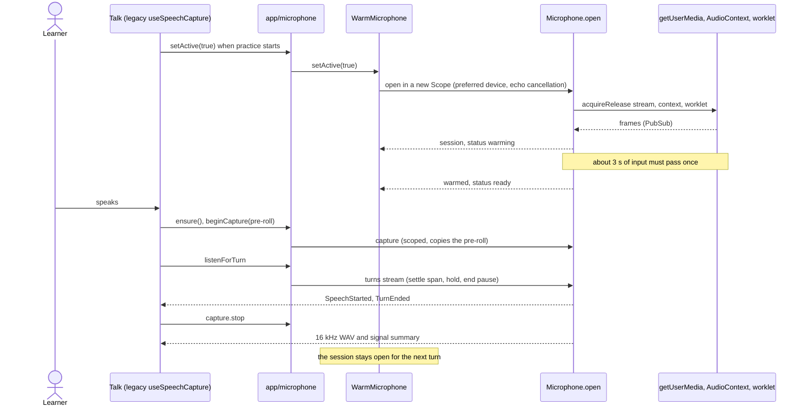
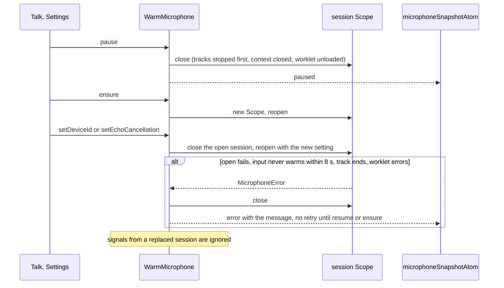
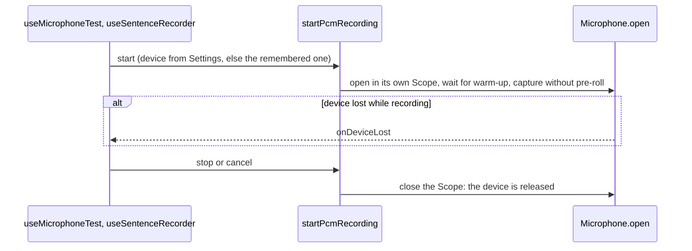
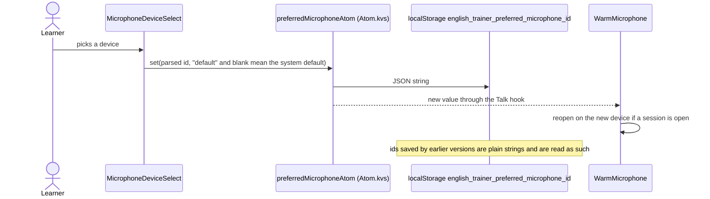

# Core audio

The microphone for practice and for one-off recordings: the warm session that stays open between
turns, PCM capture with pre-roll, turn detection and the remembered input device. Raw audio lives
in memory only; it is released when a capture's scope closes or after transcription. Whisper and
the live transcript are not here (they move with `core/speech`, #49).

Services (all in `services/`): `Microphone` opens one stream as a scoped resource, `WarmMicrophone`
owns the warm session between turns, `AudioInputsService` lists devices. `src/app/microphone` is the
Promise/callback bridge for legacy callers that have not been migrated yet.

## Warm session for practice

## Pause, device change, failure

## One-off recording (Settings test, speech check, recall)

## Remembered device

