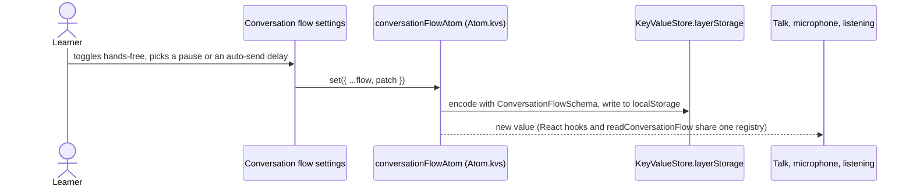
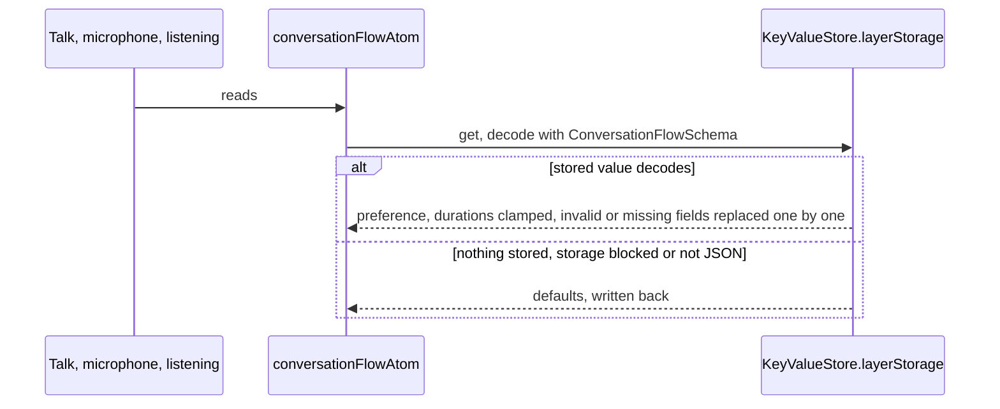

# Conversation flow preference

How the learner's conversation rhythm is stored and read. It is a pure UI preference kept in the
WebView's `localStorage`; it never crosses IPC. Settings writes it, Talk and the microphone read it
from the same atom.

## Change a setting

## Start the app

