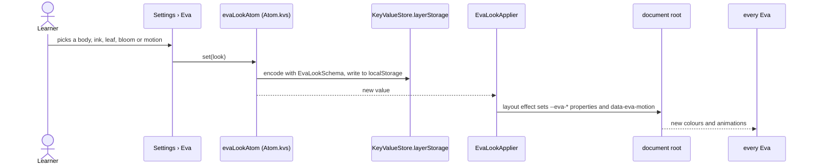
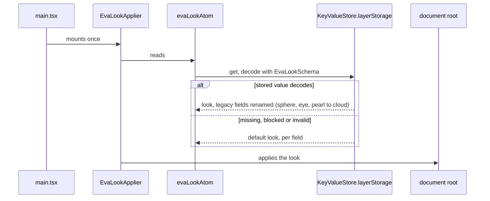

# Eva look flow

The learner picks Eva's colours and motion in Settings › Eva. The choice is a pure UI preference kept
in the WebView's `localStorage`; it never crosses IPC. The same store keeps whether Talk shows Eva
folded into the session header (`evaFoldedAtom`, default unfolded).

## Choose a look



## Start the app



## Fold Eva on Talk

```mermaid
sequenceDiagram
    actor Learner
    participant Talk as Talk (TurnStage, FoldedEva, FoldEvaButton)
    participant Fold as evaFoldedAtom (Atom.kvs)
    participant Store as KeyValueStore.layerStorage

    Learner->>Talk: Fold Eva, or Unfold Eva in the session header
    Talk->>Fold: set(isFolded)
    Fold->>Store: write to localStorage
    Fold-->>Talk: folded shows a small avatar and her state in the header, unfolded shows the full stage
    Note over Fold,Store: on start the stored boolean is read; missing or invalid means unfolded
```
