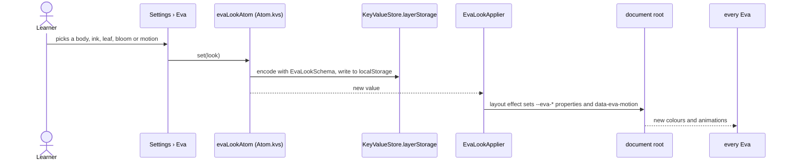
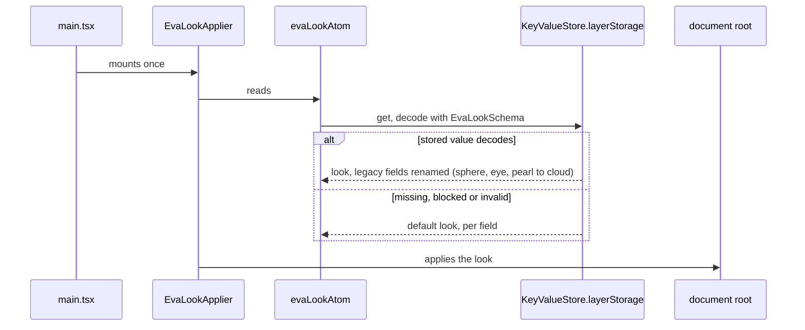

# Eva look flow

The learner picks Eva's colours and motion in Settings › Eva. The choice is a pure UI preference kept
in the WebView's `localStorage`; it never crosses IPC.

## Choose a look

## Start the app

