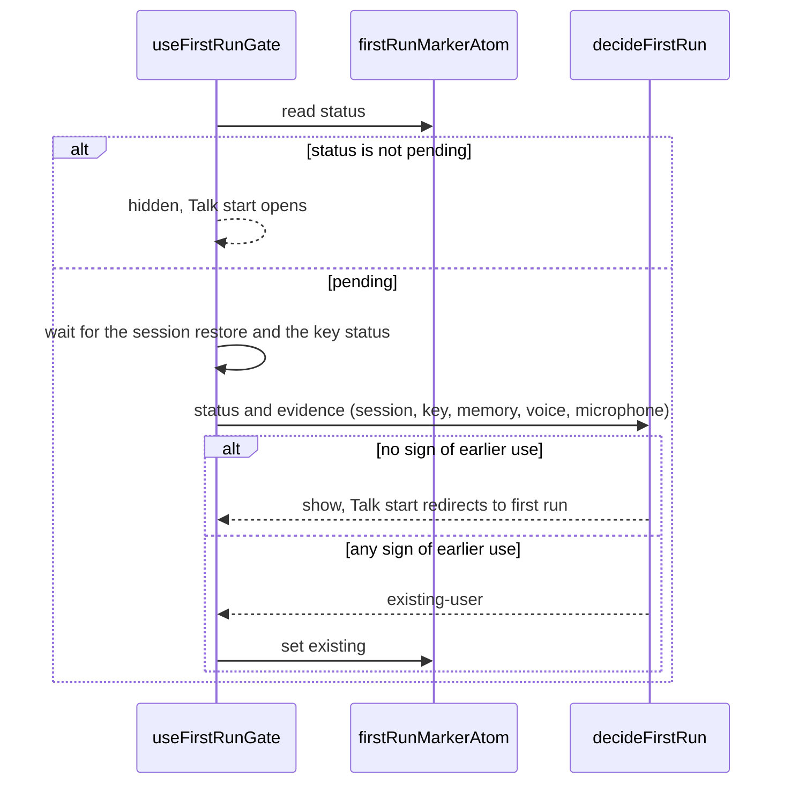

# First run

The rules that decide whether first run opens and what it records. The marker is a pure UI preference
kept in the WebView's `localStorage` under `english_trainer_first_run` as `{ status }`; it never
crosses IPC. The launch check itself (reading memory, the key and the saved choices) is legacy glue in
`src/app/routes/first-run/use-first-run-gate.ts` until the memory and practice slices are migrated; it
calls `decideFirstRun` from here.

Statuses: `pending` (never dealt with), `finished` (Start Talking), `skipped` (Skip setup),
`existing` (earlier use was found, so setup is never offered).

## Launch

## Leave

Start Talking records `finished` and Skip setup records `skipped`; both open Talk start, and launch
never shows first run again. Settings › Setup details › Run setup again opens the screen regardless of
the marker.

## Stored values

An unknown, missing or unreadable value decodes to `pending`; extra fields are dropped.
