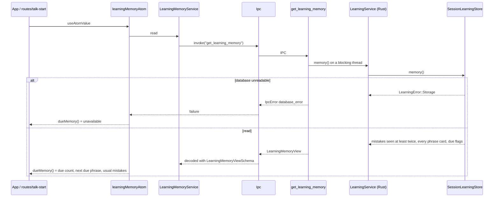
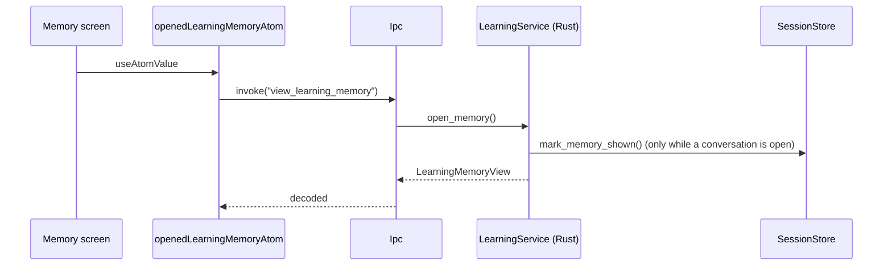
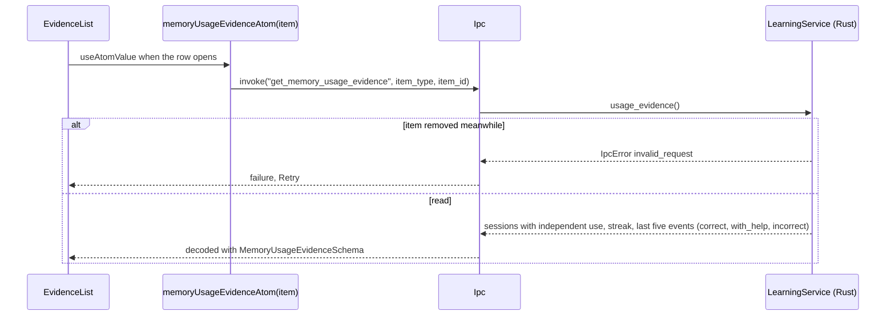
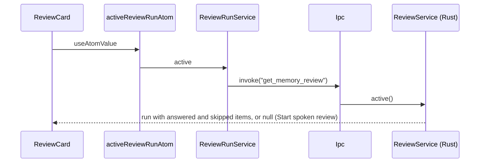

# Learning memory flow

What the learner saved (phrases) and what Eva noticed (mistakes), read from Rust. Rust owns the
learning rules ([TECHNICAL_REQUIREMENTS §9](../../../docs/TECHNICAL_REQUIREMENTS.md)); this module
only reads, decodes and exposes the data to features. `ReviewRunService` wraps the spoken review
commands (run, recall, skip, finish and the review situations) for `features/spoken-review`.

## Read the library without side effects

The Talk start screen, the sidebar badge and the first-run gate read the same data.

## Open Memory

Opening the Memory screen reads through `view_learning_memory`: Rust also records that the saved cues
were shown, which the usage review needs to tell cued answers from independent ones.

## Evidence of one item

## The saved review run

The Memory screen and the review read the same run. `activeReviewRunAtom` asks Rust for the run that
was started and not finished; "Resume review" on Memory and its counts come from it.

`startItem` (`start_item_review`) opens a run of one chosen item for "Say it now"; an open run is
returned unchanged, like `start`.

`start`, `startItem`, `submit`, `skip` and `finish` carry the `LEARNING_MEMORY` key when `features/spoken-review`
runs them, so the card, the library and the badges reload after every answer.

## Refresh after a change

Changes made through atoms (`archive`, `delete` in `features/memory-library`) carry the
`LEARNING_MEMORY` reactivity key, so every atom above reloads. That includes the saves and undos of
`features/wrap-up` and the usage review of `features/usage-review`.
