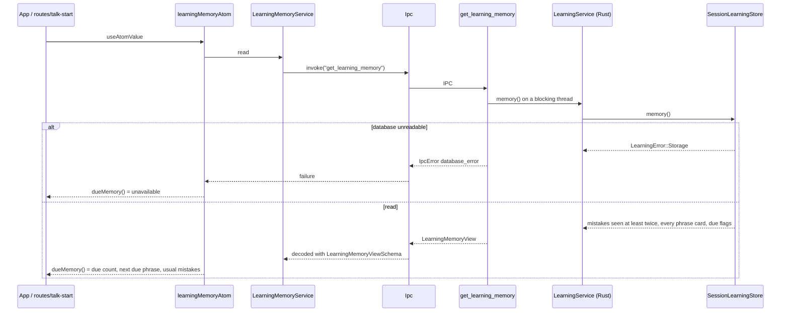
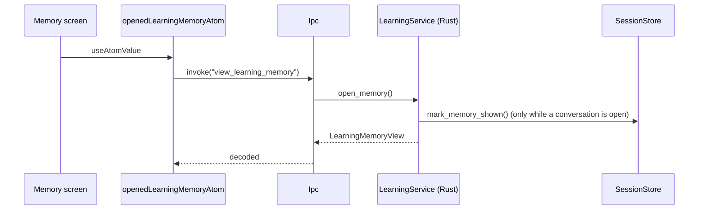
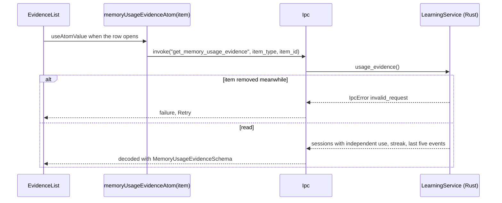

# Learning memory flow

What the learner saved (phrases) and what Eva noticed (mistakes), read from Rust. Rust owns the
learning rules ([TECHNICAL_REQUIREMENTS §9](../../../docs/TECHNICAL_REQUIREMENTS.md)); this module
only reads, decodes and exposes the data to features. Spoken review and mistake practice keep their
own commands until their slice moves.

## Read the library without side effects

The Talk start screen, the sidebar badge and the first-run gate read the same data.

## Open Memory

Opening the Memory screen reads through `view_learning_memory`: Rust also records that the saved cues
were shown, which the usage review needs to tell cued answers from independent ones.

## Evidence of one item

## Refresh after a change

Changes made through atoms (`archive`, `delete` in `features/memory-library`) carry the
`LEARNING_MEMORY` reactivity key, so every atom above reloads. Legacy code that still changes
Memory (saving a phrase from Talk, a finished review or session) calls `refreshLearningMemory()`.
