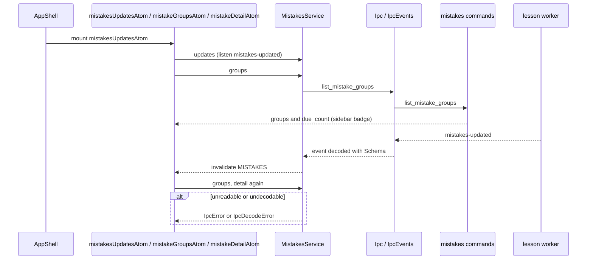

# Mistakes data flow

`MistakesService` reads the mistakes context: the groups by rule, one mistake with its lesson, a
rule card, the two actions archive and retry lesson, and the practice run commands (start, read,
answer, check, retry check, finish; the run flow is `features/mistake-run/flow.md`).
`usualRulesAtom` lists the rules that hold two or more mistakes; Talk it through, the Memory card
and the Start card read it. Atoms reload on the `MISTAKES`
reactivity key; `mistakesUpdatesAtom` (mounted by the shell) turns each `mistakes-updated` event
into that invalidation, so the sidebar badge, the list and an open card follow the background
lessons.

