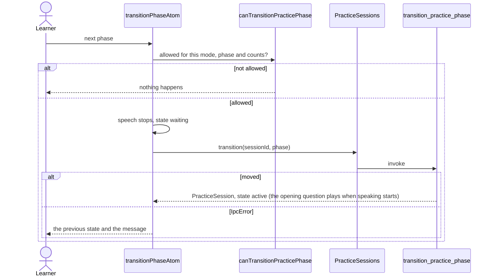

# Practice session

The open conversation: its state (`practiceStateAtom`), the commands that change its stage, and
the typed boundary to the `conversation` Rust context. Every screen that needs to know whether a
conversation is open (the sidebar, the start screen, Memory, first run, the summary) reads these
atoms; nothing here depends on a component. Sessions come from Rust as `PracticeSession`, decoded
by `PracticeSessionSchema`, which is checked against the generated binding.

## Restore on launch, start, finish

```mermaid
sequenceDiagram
    actor Learner
    participant App as App (mounts the atoms)
    participant Atoms as practiceStateAtom
    participant Service as PracticeSessions
    participant Ipc as Ipc
    participant Rust as conversation commands
    participant Speech as core/speech playback

    App->>Atoms: mount restorePracticeAtom (loading)
    Atoms->>Service: active
    Service->>Ipc: get_active_practice_session
    Ipc->>Rust: invoke
    alt a session is open
        Rust-->>Atoms: PracticeSession, state active
    else nothing open
        Rust-->>Atoms: null, state idle
    else failure
        Rust-->>Atoms: IpcError, state idle and a message
    end
    Learner->>Atoms: startPracticeAtom(options)
    Note over Atoms: only from idle or completed; state starting
    Atoms->>Service: start(options)
    Service->>Ipc: start_practice_session
    alt started
        Rust-->>Atoms: PracticeSession, state active
        Atoms->>Speech: play the opening question (voice sessions)
        App->>App: starting to active navigates to the conversation
    else IpcError
        Atoms-->>Learner: the previous state and the message
    end
    Learner->>Atoms: finishPracticeAtom
    Atoms->>Service: finish(sessionId)
    Service->>Ipc: finish_practice_session
    alt finished
        Rust-->>Atoms: wrap-up payload, state completed, speech stops
        App->>App: completed navigates to the summary
    else IpcError
        Atoms-->>Learner: state active again and the message
    end
```

## Change the stage (write then speak, reviews)



Turn counts, retry evidence and the clock are applied to the same state by the functions in
`model/updates.ts`; each ignores a snapshot of another session.
