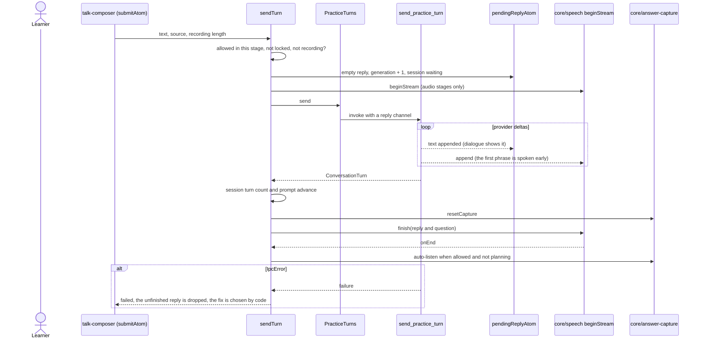
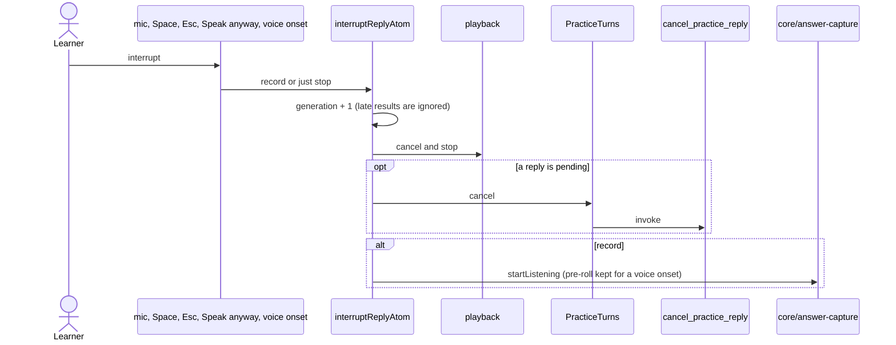
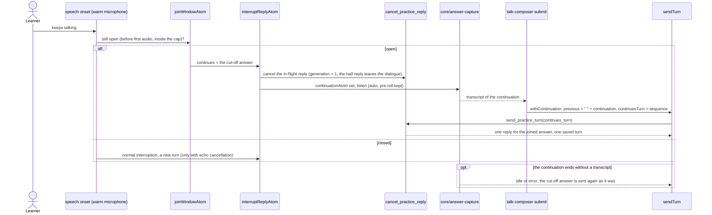

# Practice turn

The loop that joins the session, the capture and Eva's voice: send the answer, stream the reply
into the dialogue and into speech, then listen again. The conversation never waits for coaching or
help; this module does not know about them.

## Send, stream, speak, listen again

## Interrupt Eva

A committed turn that wins the race with the interruption still advances the session; only its
voice and its text on screen are dropped.

## Join speech that continues an answer

When hands-free ends an answer too early, the learner may keep talking before Eva's reply is
audible. After an automatic end (the pause, not a manual send, Space or a typed answer) in a spoken
conversation with auto-listen on, `sendTurn` opens the join window: `joinWindowAtom` holds the
answer, its sequence and the time. It lasts until the reply's first audio starts, at most
`JOIN_WINDOW_MS` (4 s). The cap is checked by timestamp when a voice onset arrives, not by a timer.

If the cut-off turn had already been saved when the cancel arrived, `continues_turn` makes Rust
replace it (and its coaching) instead of adding a turn, and the session's turn count is not
advanced a second time (`committedTurnAtom`). A reply that was cancelled first saved nothing, so
the joined text is a plain new turn.

## Effects that run for the whole app

`practiceTurnEffectsAtom` is mounted by `App`: it keeps the warm microphone on while a spoken stage
can take an answer (device and echo cancellation follow the preferences), resets capture and
speech when the session or stage changes, prewarms the conversation provider and Whisper, starts
auto-listen after a reply, and watches the microphone for the learner talking over Eva.
