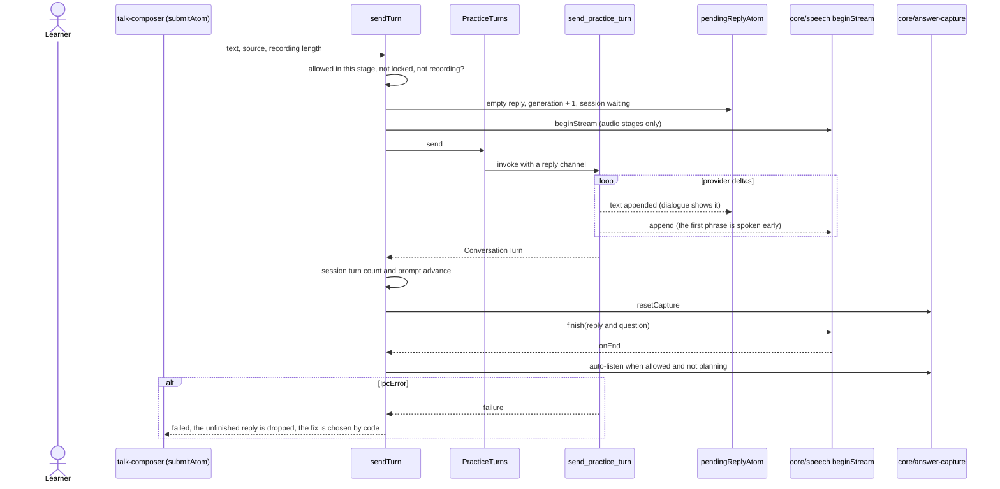
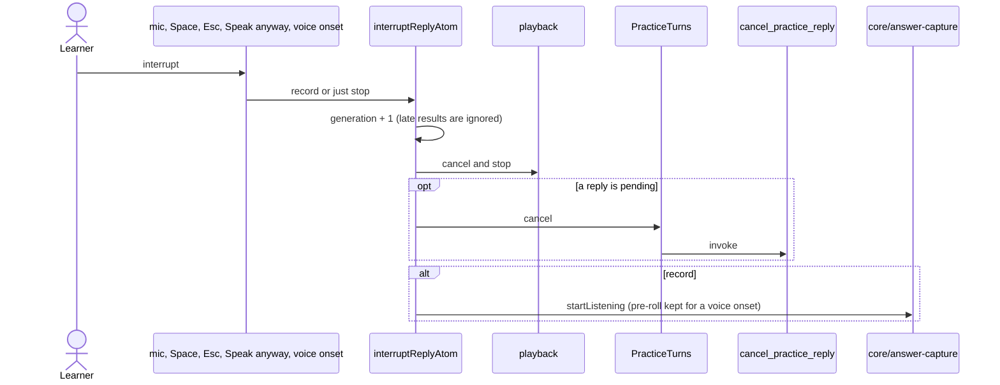

# Practice turn

The loop that joins the session, the capture and Eva's voice: send the answer, stream the reply
into the dialogue and into speech, then listen again. The conversation never waits for coaching or
help; this module does not know about them.

## Send, stream, speak, listen again

## Interrupt Eva

A committed turn that wins the race with the interruption still advances the session; only its
voice and its text on screen are dropped.

## Effects that run for the whole app

`practiceTurnEffectsAtom` is mounted by `App`: it keeps the warm microphone on while a spoken stage
can take an answer (device and echo cancellation follow the preferences), resets capture and
speech when the session or stage changes, prewarms the conversation provider and Whisper, starts
auto-listen after a reply, and watches the microphone for the learner talking over Eva.
