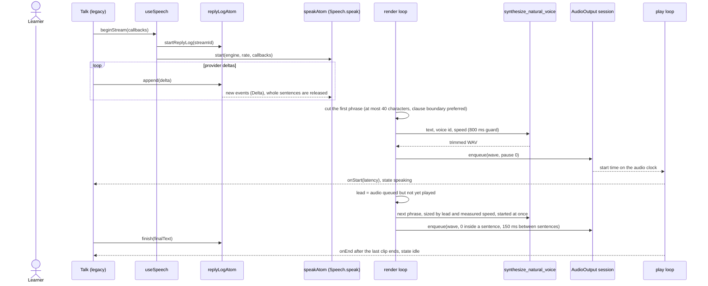
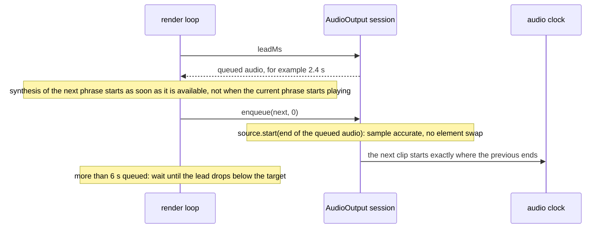
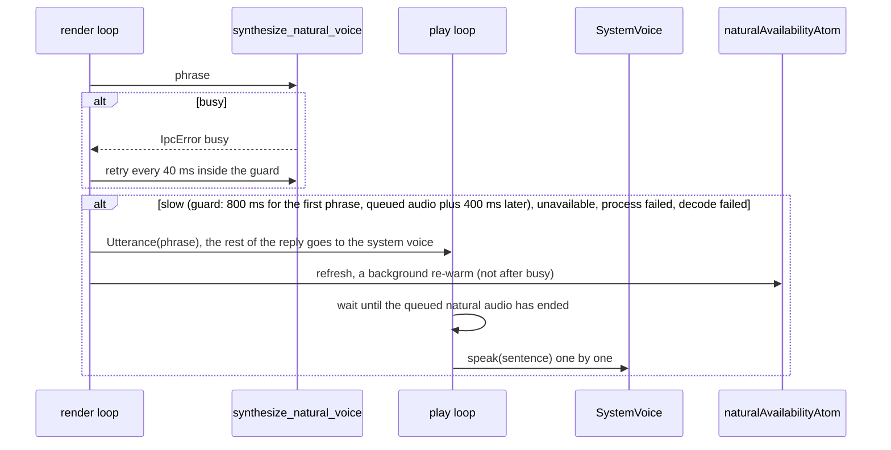
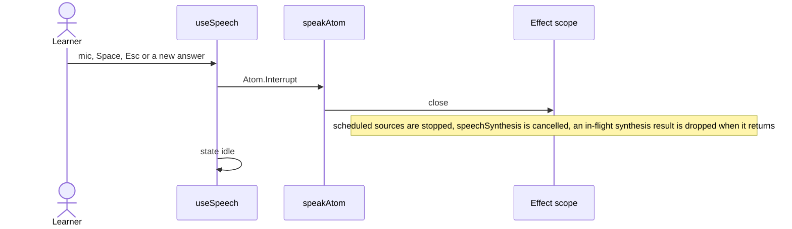
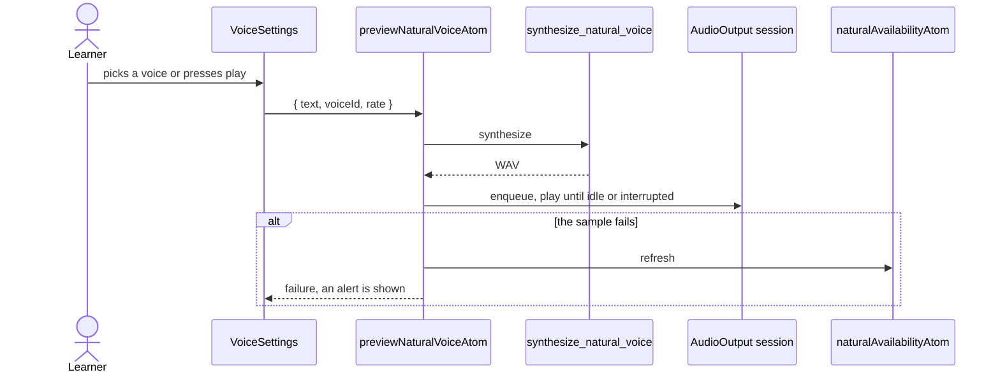

# Speech output flow

Eva's voice: the reply text goes in, audio comes out. The natural voice is the bundled Supertonic
model behind the `voice` Rust context; system voices (`speechSynthesis`) cover everything else.
`useSpeech` is the facade legacy screens call; it writes the reply into `replyLogAtom` and starts
`speakAtom`, whose Effect owns the whole stream. Interrupting is closing that Effect's scope.

## Speak a streamed reply

## Why there is no gap inside a sentence

Rust trims model padding to 40 ms before and 50 ms after the speech, so the silence that remains at
a join is about 90 ms. Between sentences the pause is the 90 ms plus 150 ms of explicit pause.

## Fallback to system speech

## Interrupt

## Sample in Settings and first run

