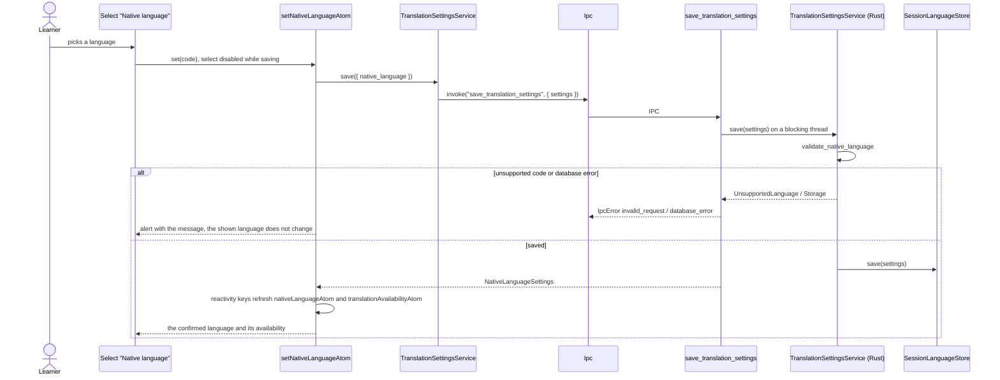
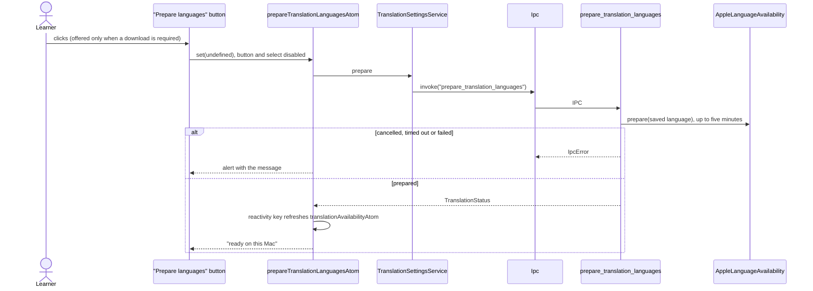

# Translation settings flow

The learner's native language and whether Apple Translation has its language pair on this Mac.
Read and changed by Settings (`TranslationSettings`); the "Prepare languages" action is also offered
by the text-translation panel. The lookup itself (`translate_text`, `explain_text`) lives in
`features/text-translation`.

## Read the language and its availability

```mermaid
sequenceDiagram
    actor Learner
    participant Component as TranslationSettings
    participant Atoms as nativeLanguageAtom / translationAvailabilityAtom
    participant Service as TranslationSettingsService
    participant Ipc
    participant Command as get_translation_settings / get_translation_status
    participant Rust as TranslationSettingsService (Rust)
    participant Store as SessionLanguageStore
    participant Helper as AppleLanguageAvailability

    Learner->>Component: opens Settings
    Component->>Atoms: useAtomValue
    Atoms->>Service: get
    Service->>Ipc: invoke("get_translation_settings")
    Ipc->>Command: IPC
    Command->>Rust: get() on a blocking thread
    Rust->>Store: load()
    alt database unreadable
        Store-->>Rust: TranslationSettingsError::Storage
        Command-->>Ipc: IpcError database_error
        Atoms-->>Component: "Translation settings could not be loaded" + Retry
    else saved or default (Russian)
        Command-->>Atoms: { native_language }
        Atoms-->>Component: the selected language
    end
    Atoms->>Service: status
    Service->>Ipc: invoke("get_translation_status")
    Command->>Rust: status() on a blocking thread
    Rust->>Store: load()
    Rust->>Helper: status(language)
    alt helper failed
        Command-->>Ipc: IpcError (unavailable, timeout, process_failed, ...)
        Atoms-->>Component: availability message + Retry; the language stays editable
    else
        Command-->>Atoms: TranslationStatus
        Atoms-->>Component: "ready on this Mac" or "Prepare languages"
    end
```

## Change the native language



## Prepare languages


