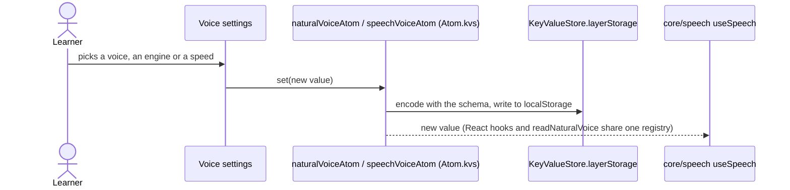
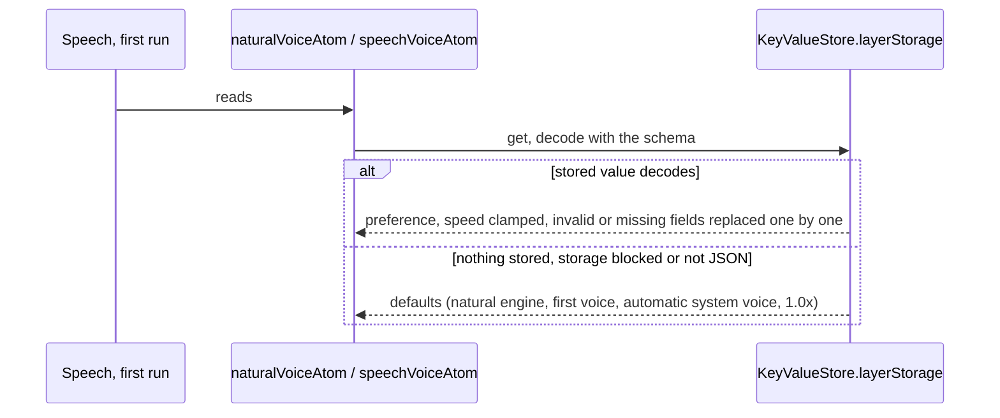

# Voice preference

How the learner's voice choices are stored and read. They are pure UI preferences kept in the
WebView's `localStorage`; they never cross IPC. Settings writes them, speech playback and first run
read them from the same atoms.

Two keys keep the shapes earlier versions stored:

- `english_trainer_natural_voice`: `{ engine: "natural" | "system", voiceId: 0..9 }`
- `english_trainer_voice`: `{ voiceURI: string | null, rate: 0.85..1.2 }` (system voice and speed)

## Change a preference

## Start the app

