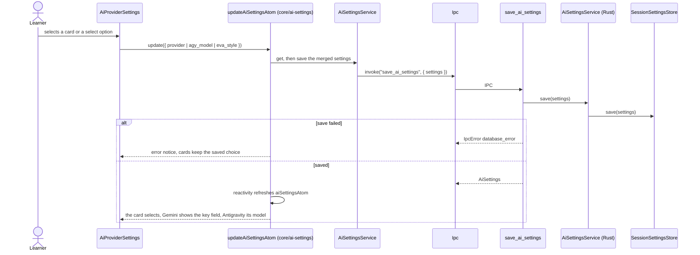
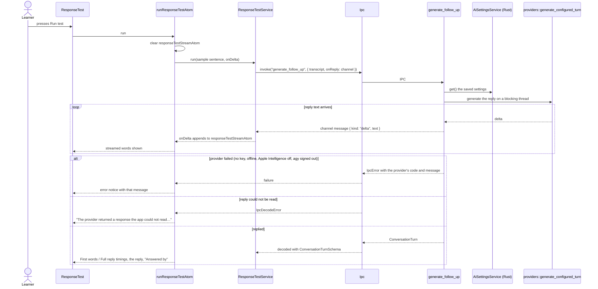

# AI provider flow

Settings › Conversation AI: choosing the provider, the Antigravity model, Eva's style and the
"Test AI response" check. The saved values live in `core/ai-settings` (see its `flow.md`); the
Gemini key field is composed in by the screen as a slot, because features never import each other.

## Choose a provider, model or style

## Test the AI response

