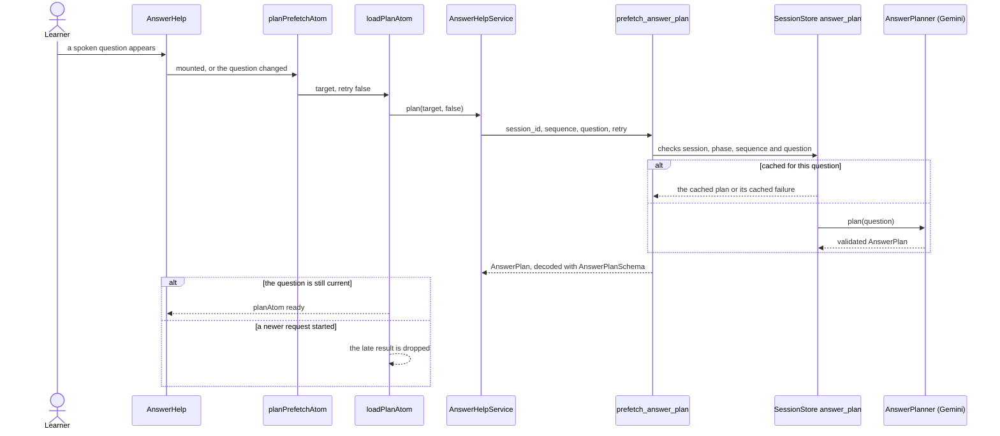
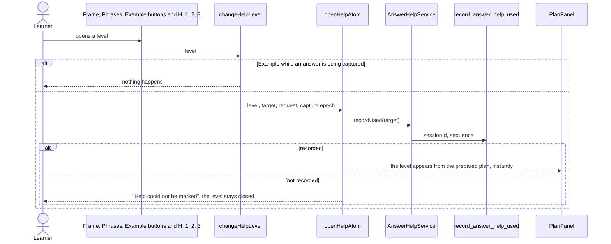
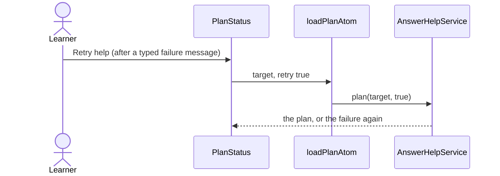
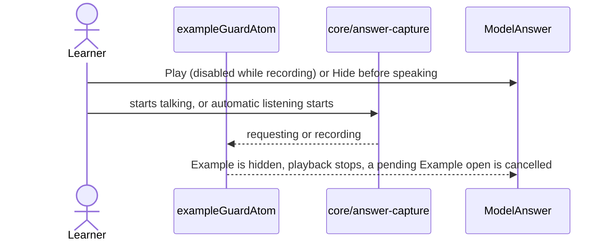
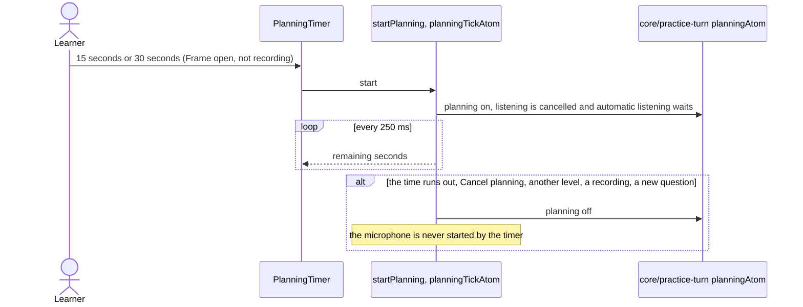

# Answer help flow

The "Need help?" planner above the composer: Frame (three steps), Phrases and Example (a model
answer), with an optional 15 or 30 second planning timer on the Frame. Help never blocks the
conversation: the plan is prepared in the background, the learner can speak at any time, and a
failure only offers a retry. The route (`routes/talk`) decides when help is available and mounts
`AnswerHelp`; `useAnswerHelpEffects` keeps the Example guard and the commands alive.

## Prepare the plan

Nothing is shown and no use is recorded while the plan is only prepared.

## Open a level

Help is recorded once per answer (`help_used` feeds the dialogue and the usage review), and a level
only appears after that. A newer choice, another question or a capture that started in between
makes the answer to an old request stale, and it is dropped.

## Retry

Only an explicit retry asks the provider again after a failure.

## Example and the microphone

## Planning timer

