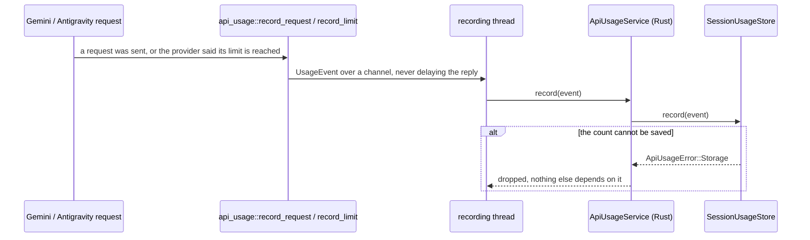
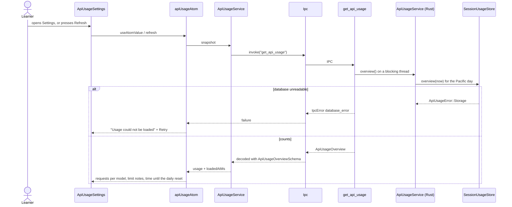
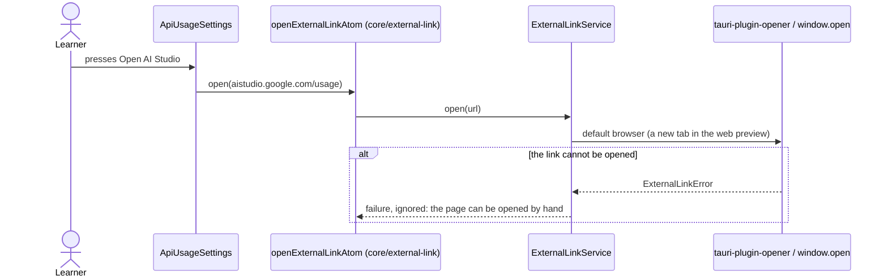

# API usage flow

Settings › Usage: what the app can tell about the Gemini and Antigravity limits. Neither provider
reports its remaining quota, so requests are counted where they are sent and limit errors are
noted where they arrive; Google's own page shows the exact figures.

## Record usage (providers)

## Show usage

## Open Google AI Studio

