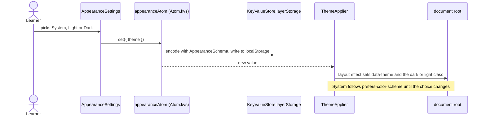
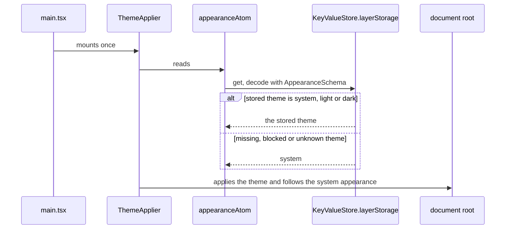

# Appearance flow

The learner picks System, Light or Dark in Settings › Appearance. The choice is a pure UI preference
kept in the WebView's `localStorage`; it never crosses IPC.

## Choose a theme

## Start the app

