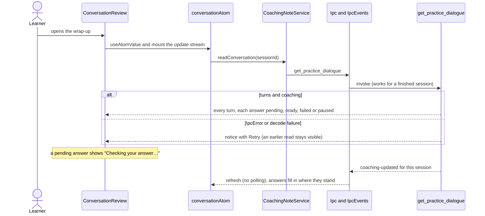
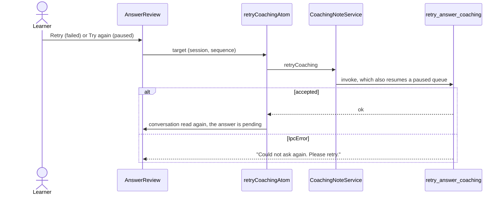
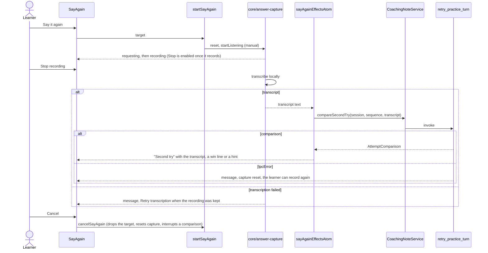

# Coaching note

The review of one answer, and of the whole conversation on the wrap-up: what the learner said, the
more natural version with the changed words marked, one short reason, Hear it and Say it again.
Talk never shows it; Talk only marks an answer (`features/talk-dialogue`). The wrap-up screen
(`screens/wrap-up`) renders `ConversationReview`, and the write-then-speak review stage renders
`AnswerReview` per answer. Both take an optional `renderAnswerActions` slot that adds actions beside
Hear it; the wrap-up screen uses it for the per-answer save of `features/wrap-up`.

## Read the conversation and fill in pending answers

The stream is the same `coaching-updated` signal the wrap-up already listens to. It is read here
too because a retried answer that gave up earlier is not counted as pending, so the wrap-up
summary would not refresh for it.

## Check an answer again

## Say it again

Capture is `core/answer-capture` (one microphone path for the whole app). The feature only decides
which answer is being re-spoken (`sayAgainTargetAtom`) and reacts to the transcript.

Only one answer is re-spoken at a time: the other answers' buttons are disabled while one is active.
`sayAgainActiveAtom` lets the route lock the turn composer while the write-then-speak review stage
is open. A comparison lasts for the life of the screen; Rust also saves it (`attempt_comparisons`).
