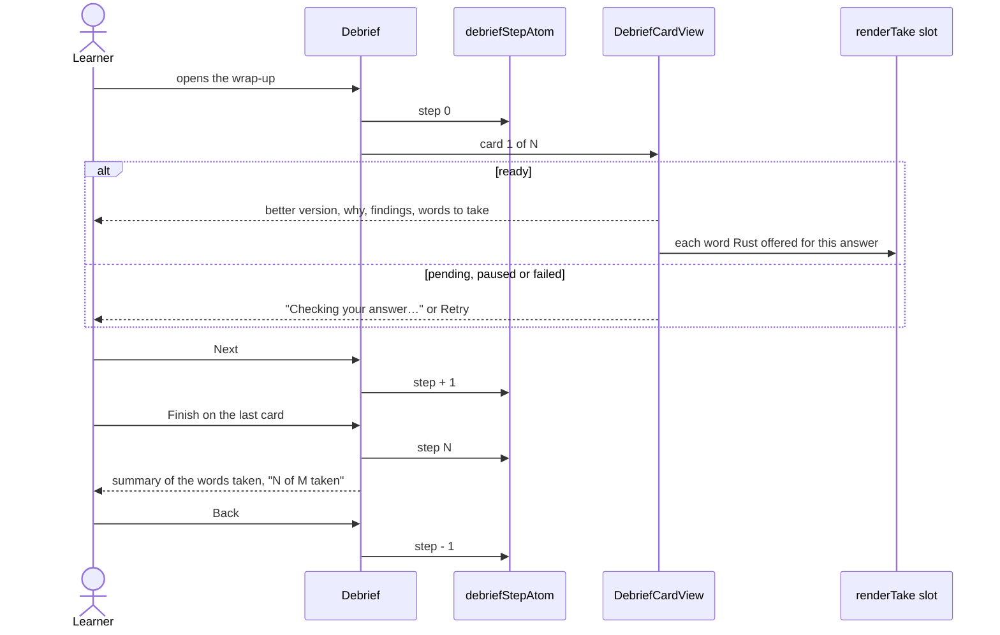
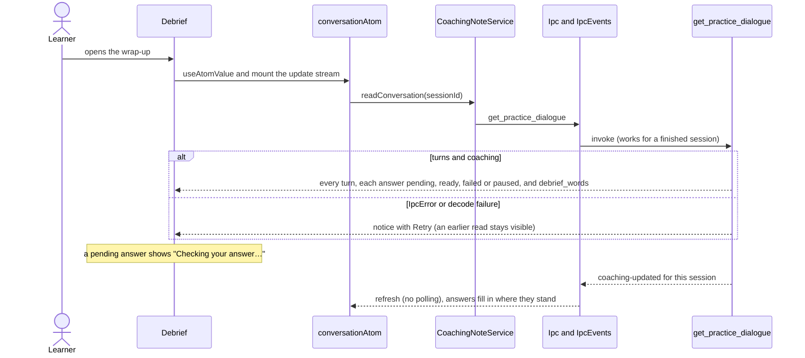
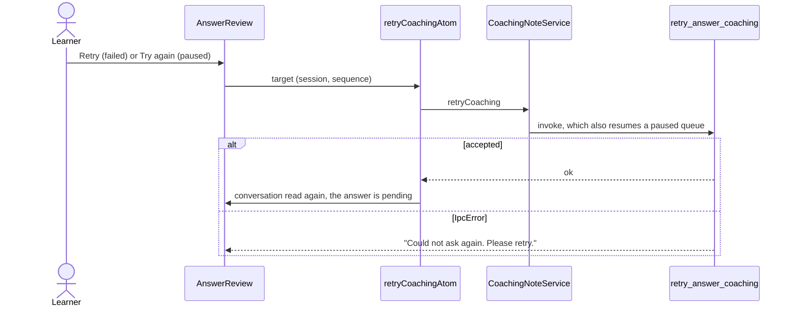
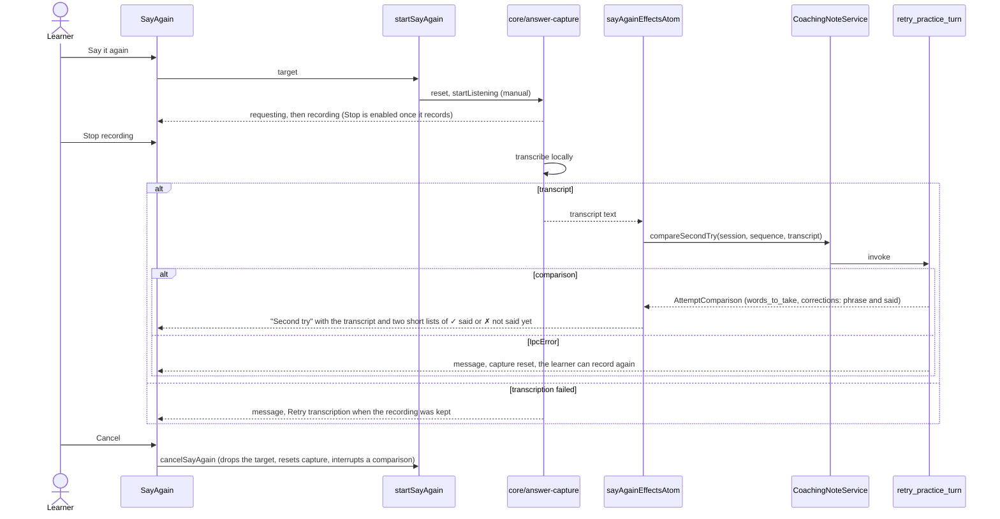

# Coaching note

The review of one answer, and the Debrief of the whole conversation on the wrap-up. Talk never
shows it; Talk only marks an answer (`features/talk-dialogue`). The wrap-up screen
(`screens/wrap-up`) renders `Debrief`, and the write-then-speak review stage renders `AnswerReview`
per answer. `Debrief` takes `renderTake` (the Take button of `features/wrap-up`) and `isTaken`, so
this feature never imports that one.

## Step through the Debrief

One card per spoken answer, in order, with "3 / 8" and Back / Next. A card shows Eva's question,
what was said, the better version with changed words marked, one line of why, the findings grouped
as Fix, Better and Missing word, and the words to take. Only words in `debrief_words` (at most five
per session, chosen in Rust) get a Take button. After the last card, Finish opens a summary of the
words taken. A taken word the usage review saw the learner use on their own in that answer shows
"✓ Used on your own: <phrase>" under the answer, and the summary lists those words too
(`debrief_wins`, read from Rust; With help never appears). Below them "Your habits" lists the
plain words Rust counted across recent conversations (`habits`, at most three) as
"very 3.4 → 1.2 per 100 words"; the block is absent while Rust sends none. A pending, paused or failed answer shows the same status line and retry as
`AnswerReview`.

## Read the conversation and fill in pending answers

The stream is the same `coaching-updated` signal the wrap-up already listens to; Rust also emits it
when a usage review lands, so a win fills in without a reload. It is read here
too because a retried answer that gave up earlier is not counted as pending, so the wrap-up
summary would not refresh for it.

## Check an answer again

## Say it again

Capture is `core/answer-capture` (one microphone path for the whole app). The feature only decides
which answer is being re-spoken (`sayAgainTargetAtom`) and reacts to the transcript.

The target is the whole better version (`b2_rewrite`), the same text Hear it plays. Rust checks the
local transcript phrase by phrase with `learning::contains_phrase` (`conversation/domain/retry_check.rs`):
each of the card's words to take, and each corrected fragment (a finding's `improved`, an upgrade's
`improved`, a gap word). There is no score. A retry is cued practice: it changes no Memory status or
evidence.

Only one answer is re-spoken at a time: the other answers' buttons are disabled while one is active.
`sayAgainActiveAtom` lets the route lock the turn composer while the write-then-speak review stage
is open. A comparison lasts for the life of the screen; Rust also saves it (`attempt_comparisons`).
