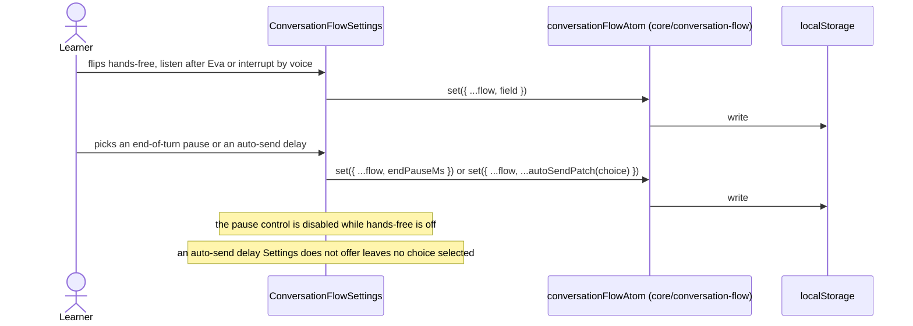

# Conversation flow settings

Settings › Conversation flow edits the preference that Talk and the microphone read. The
preference itself (schema, atom, rules) lives in `core/conversation-flow`; this feature is the group
of controls.

## Change a setting

