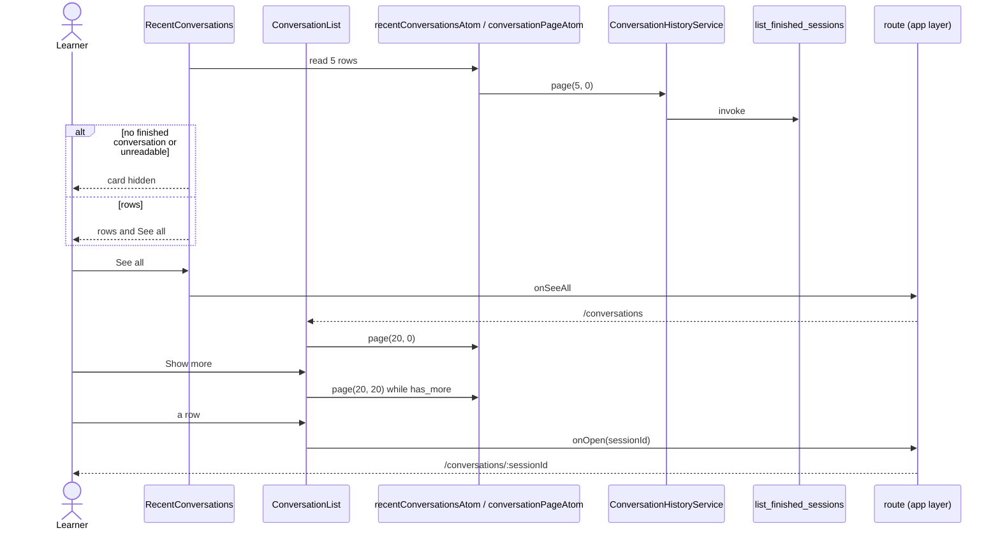

# Conversation history

The "Recent conversations" card on the Talk start screen (the last 5 finished conversations) and the
paged list of all of them. A row shows the topic (or the first question of an open conversation),
the day, the number of answers and the rule to practise when there is one. Opening a row is the
app layer's job: the feature only reports the session id.

Rust (`list_finished_sessions`, `conversation/service/history.rs`) lists finished sessions that have at
least one answer, newest first, and returns `has_more` so the list needs no total.

Pages are atoms that are not kept alive, so the list reads again each time the screen opens and shows
a conversation finished a moment ago.
