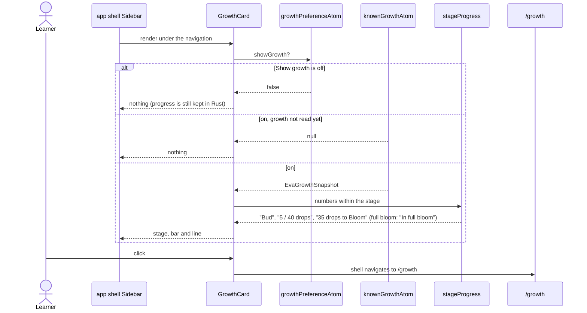
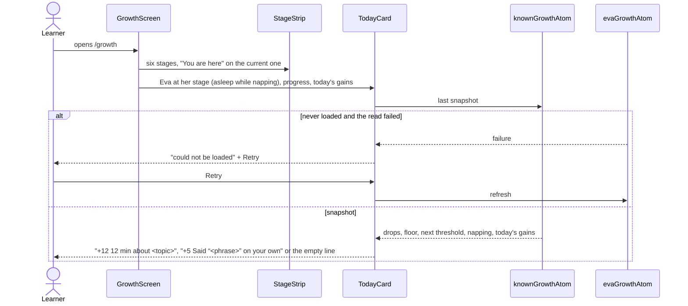

# Eva growth flow

The sidebar growth card and the three parts of the Growth screen: the stage strip, "How Eva grows"
and "Today". The numbers come from Rust (`get_eva_growth`) through `core/eva-growth`; the feature only
words them. Nothing wilts, there are no streaks and no guilt copy: a nap is a mood, not a penalty.

## Read the card

## Show the Growth screen

