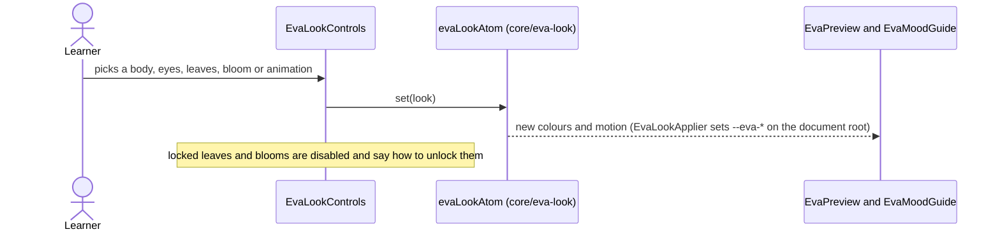
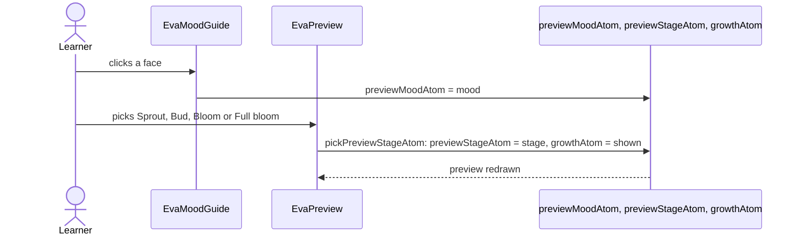
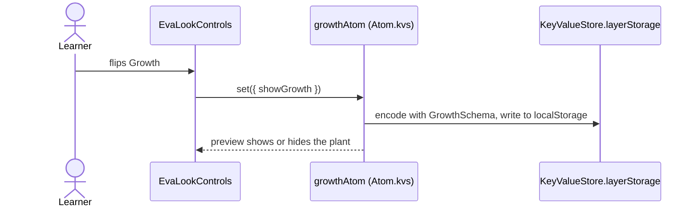
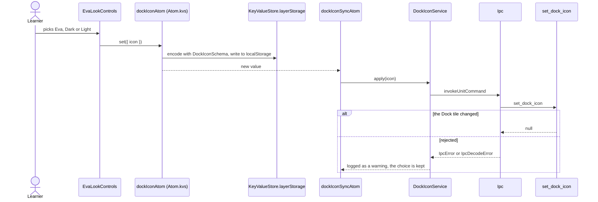
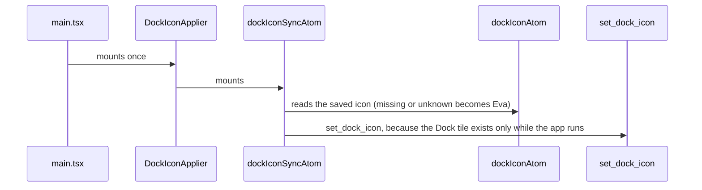
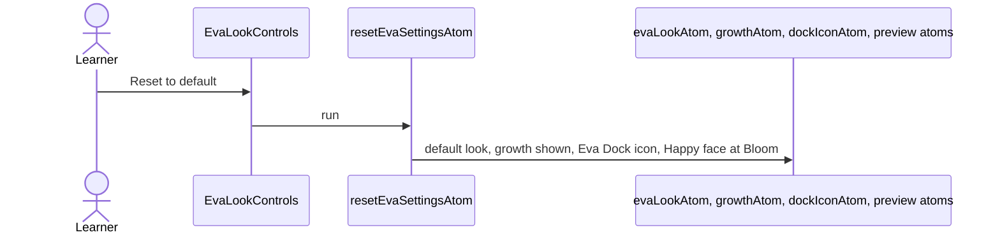

# Eva settings flow

Settings › Eva changes how Eva looks (`core/eva-look`), whether her growth shows, which Dock icon the
app uses, and previews her faces. Everything except the Dock icon is a pure UI preference kept in
the WebView's `localStorage`. The Dock icon crosses IPC because only the Dock tile can change it.
The growth switch is a stored visual preference: nothing reads it yet except this preview.

## Choose a look

## Preview a face or a growth stage

## Switch growth

## Choose the Dock icon

## Start the app

## Reset to default

