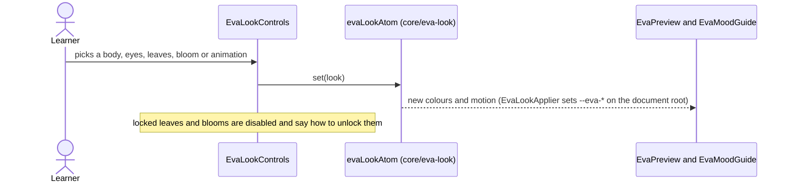
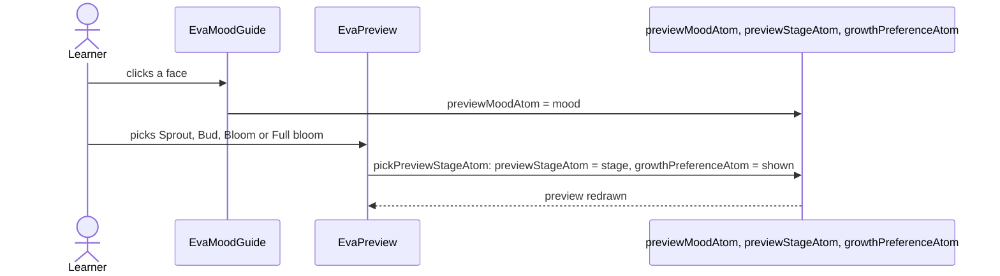
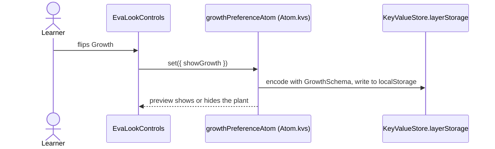
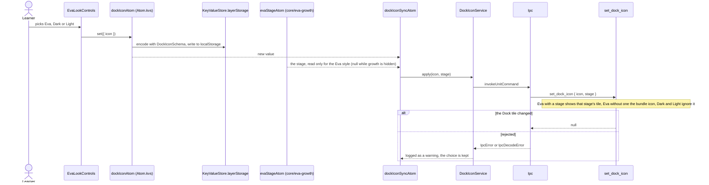
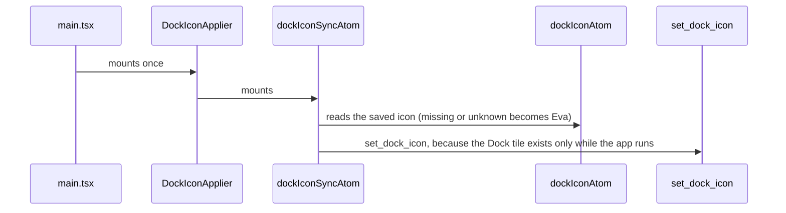
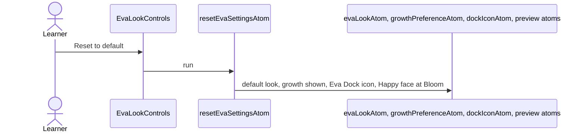

# Eva settings flow

Settings › Eva changes how Eva looks (`core/eva-look`), whether her growth shows, which Dock icon the
app uses, and previews her faces. Everything except the Dock icon is a pure UI preference kept in
the WebView's `localStorage`. The Dock icon crosses IPC because only the Dock tile can change it.
The growth switch is a stored visual preference that lives in `core/eva-growth`; every Eva and the sidebar card read it.

## Choose a look

## Preview a face or a growth stage

## Switch growth

## Choose the Dock icon

Eva's stage changing (a new drop, or Show growth flipped) re-applies the Dock icon the same way; the
sync reads the stage only for the Eva style, so Dark and Light never re-apply and an unchanged
style and stage never cross IPC again.

## Start the app

## Reset to default

