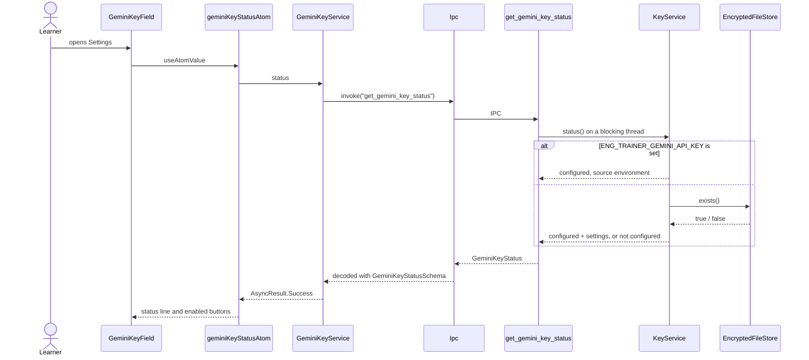
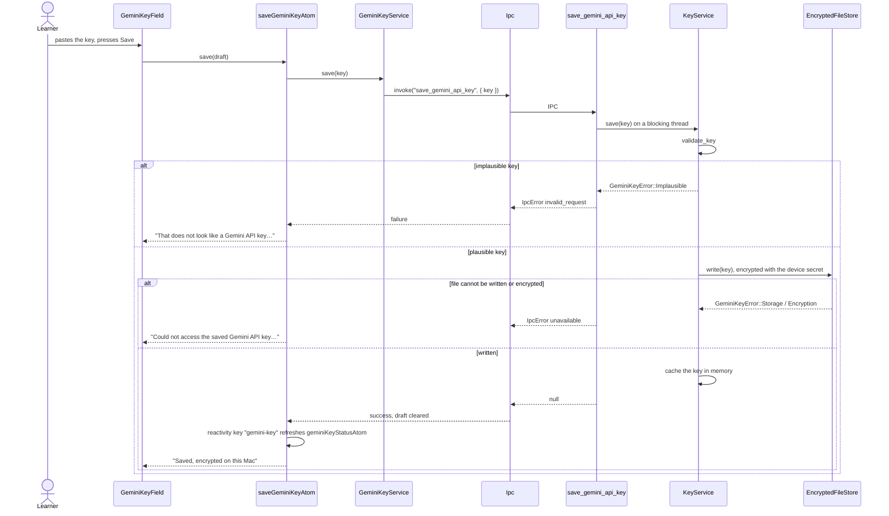
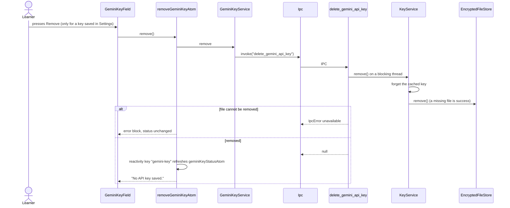
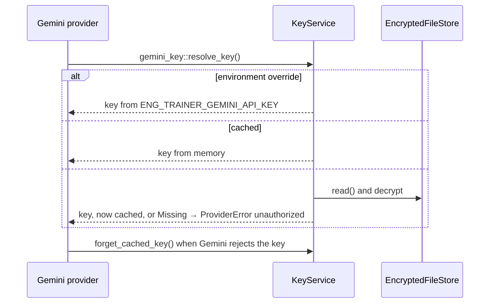

# Gemini key flow

Used by Settings › Conversation AI (`GeminiKeyField`) and first run (`GeminiKeyList`). The key goes
from the learner to an encrypted file; only its status ever comes back to the UI.

## Show the status

## Save a key

## Remove the key

## A provider needs the key

## First run list

`GeminiKeyList` is the same save flow as `GeminiKeyField` in the grouped-list layout: an API key row
with a Saved mark, a save row, and the free-key link opened through `core/external-link`.
