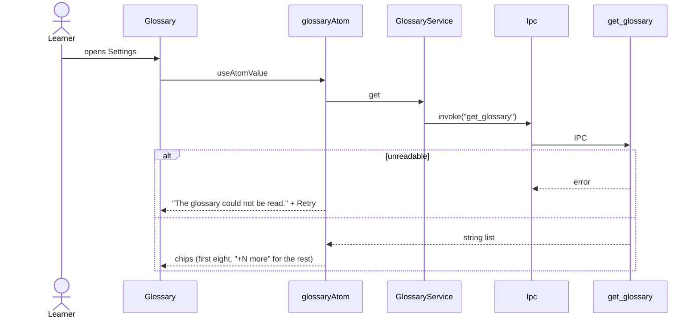
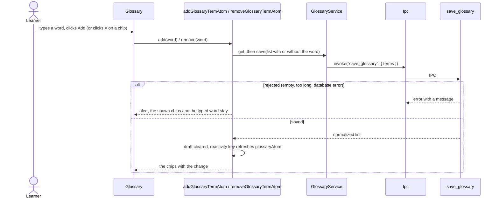

# Personal glossary

The Settings chips of words and names speech recognition should know. Rust merges them with terms
taken from the profile (`effective_glossary_terms`); the UI edits only the manual list. The commands
`get_glossary` and `save_glossary` belong to the audio context and are migrated with the speech step.

## Read the glossary

## Add or remove a word

