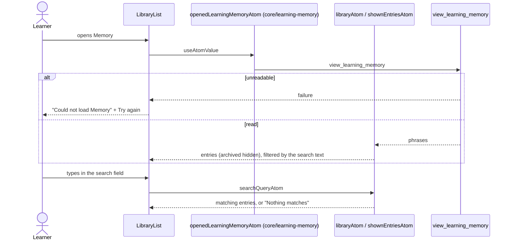
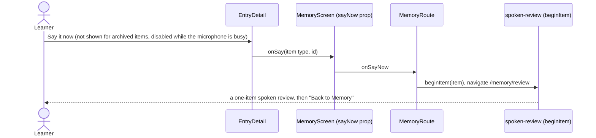
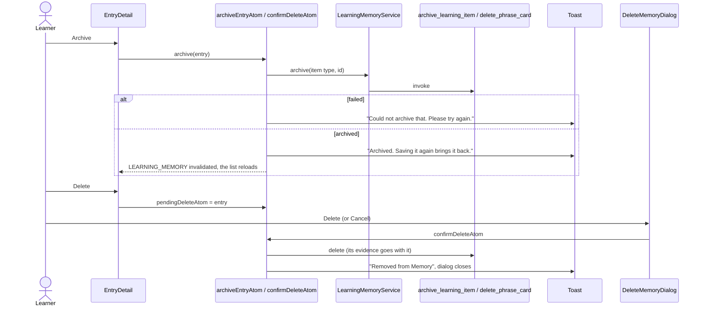

# Memory library flow

The list and details under the cards on the Memory screen: saved phrases, what conversations
showed about each one, and archive and delete. Mistakes live in the Mistakes section (`core/mistakes`).

```text
MemorySearch            search field in the screen header (searchQueryAtom)
StatusSummary           "Where they are": counts of New, Learning, Improving, Stable
LibraryList             "Show archived", the phrase list
  MemoryRow             wording, source, status, next review, "On your own" count
    EntryDetail         next review, gap, kind, explanation, EvidenceList, Say it now, Archive, Delete
DeleteMemoryDialog      asks before a delete
```

Rust sorts the list by next review. Archived items are hidden unless "Show archived" is on.

## Show and search



## Open a row

Opening a row shows the details and loads the evidence for that one item from Rust
(`memoryUsageEvidenceAtom`, see `core/learning-memory/flow.md`). Selecting text in a row does not
toggle it, so a word can be translated (`data-word-lookup`).

The kind comes from Rust: a phrase card carries `kind` (computed on read, never stored). Each evidence event is tagged by its outcome: `correct` is "On your own",
`with_help` is "With help" (the answer used help, or the item was cued first), `incorrect` is
"Slipped back". `uncertain` events are not listed. Only "On your own" feeds the count in the row.

## Say it now



The feature never imports the review: the route composes the two.

## Archive and delete


