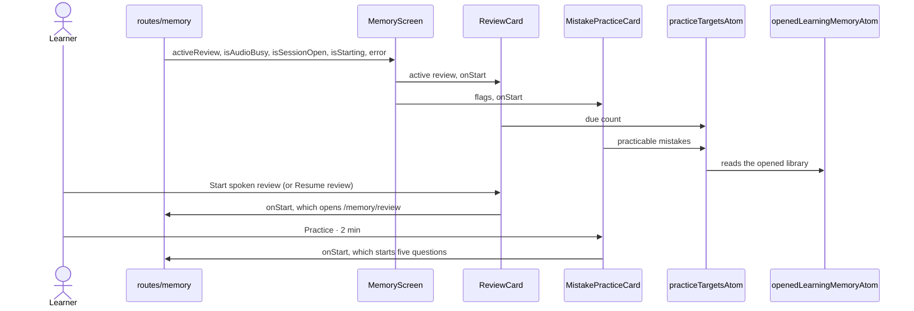

# Memory practice cards flow

The two cards at the top of Memory that start spoken practice: the spoken review and "Practice my
usual mistakes". The cards only offer and start; the review screen and the practice session are
still legacy (`features/memory`, `features/practice`) until their slices move, so what they need
from the app arrives through props.

- Review offers "Resume review" for a saved run, "Start spoken review" when something is due and
  nothing otherwise ("All caught up").
- Practice is blocked while Memory loads or failed, while a conversation is open, while the
  microphone is busy and while no mistake has been seen at least twice
  (`isPracticableMistake`, the same bounds Rust applies).
