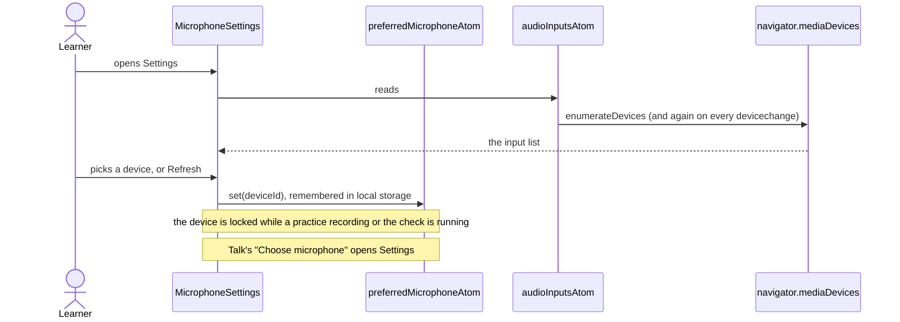
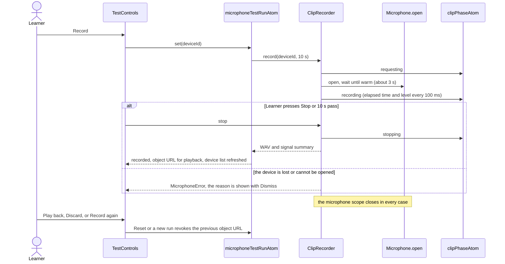

# Microphone settings flow

Settings › Microphone: the input device, a live level and a ten-second check that is recorded and
played back. Everything is on `core/audio`: the remembered device is `preferredMicrophoneAtom`, the
device list is `audioInputsAtom`, the check is `microphoneTestRunAtom` over the `ClipRecorder`
service. The clip is held in memory as an object URL for playback only; it is never saved,
transcribed or sent, and it is released when the learner discards it, records again or leaves
Settings.

## Choose an input device

## Record the check and play it back

## First run check

`MicrophoneCheck` is the compact variant used by the first-run screen. Nothing is requested until the
learner presses Allow Microphone; that starts the same one-shot test as above. While it records, the
list shows the device choice and the live level, and "We can hear you" latches once the level reaches
`HEARD_SPEECH_LEVEL`. Check again starts a new test. Denial or a missing device shows the failure and
keeps the button.
