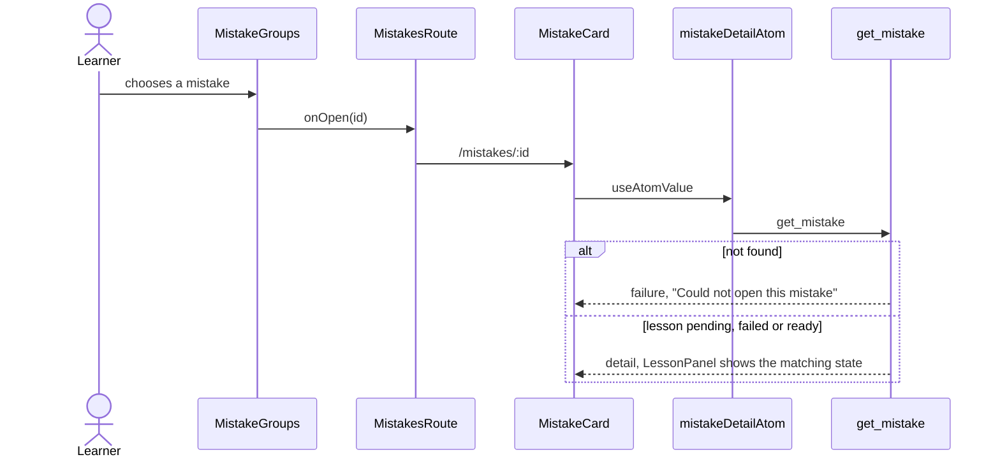

# Mistake library flow

The list of rule groups, the mistake card with its lesson, and the rule card. Data comes from
`core/mistakes`; this feature owns the two actions.

```text
MistakeGroups      groups by rule, "Not sorted yet", loading, failure, empty
  RuleGroup        title, count, fixed, "Came back on <date>", progress, first mistakes, full rule
    MistakeRow     said -> version to keep with marked words, step dots
MistakeCard        question, said, version to keep, Hear it, Archive, ladder
  LessonPanel      ready: why, contrast, examples, word; pending; failed with Retry
PracticeActions    Talk it through (F12), Practise (disabled, "Coming soon")
```

## Open a mistake



## Archive and retry

```mermaid
sequenceDiagram
    actor Learner
    participant Card as MistakeCard / LessonPanel
    participant Atoms as archiveMistakeAtom / retryLessonAtom
    participant Service as MistakesService
    participant Rust as archive_mistake / retry_mistake_lesson

    Learner->>Card: Archive
    Card->>Atoms: id and onArchived
    Atoms->>Service: archive
    Service->>Rust: archive_mistake
    alt fails
        Atoms-->>Learner: toast "Could not archive that"
    else archived
        Atoms-->>Learner: toast, back to the list, MISTAKES reloads
    end
    Learner->>Card: Retry (failed lesson)
    Card->>Atoms: id
    Atoms->>Service: retryLesson
    Service->>Rust: retry_mistake_lesson
    Rust-->>Card: lesson pending again; mistakes-updated brings the result
```

## Talk it through

`PracticeActions` calls `onTalkItThrough`; `MistakesRoute` starts the existing F12 practice
(`startMistakePracticeAtom`), enabled when a repeated mistake exists and no conversation is open.
"Practise N" and "Practise this" stay disabled with the tooltip "Coming soon" until the practice
run exists.
