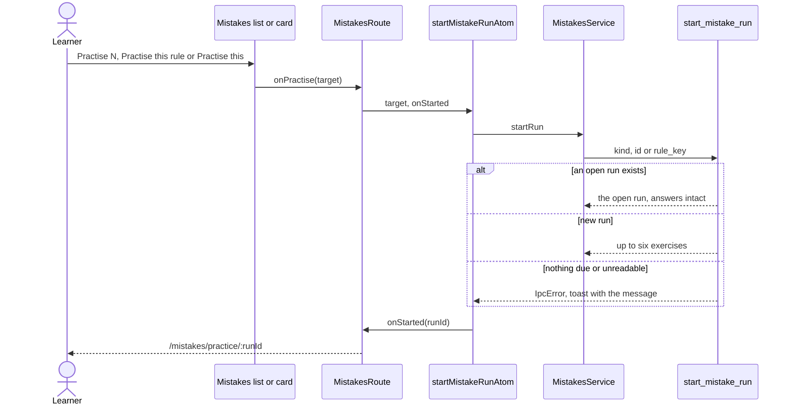
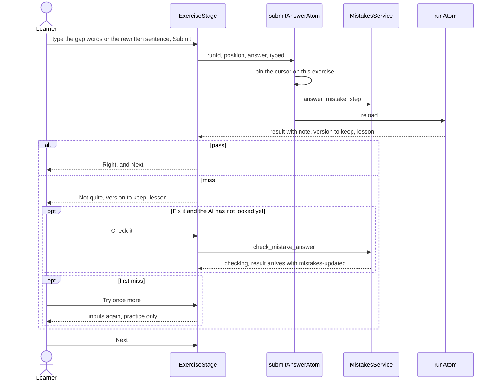
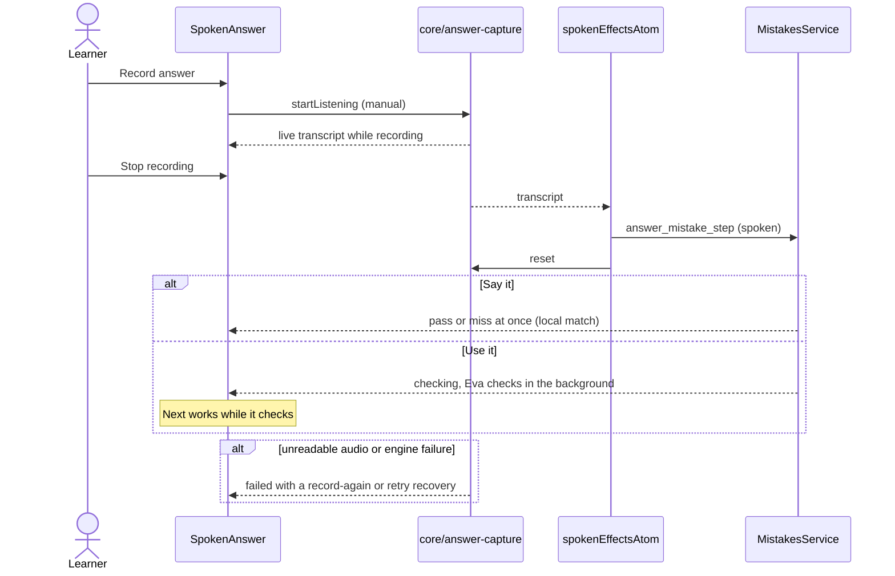
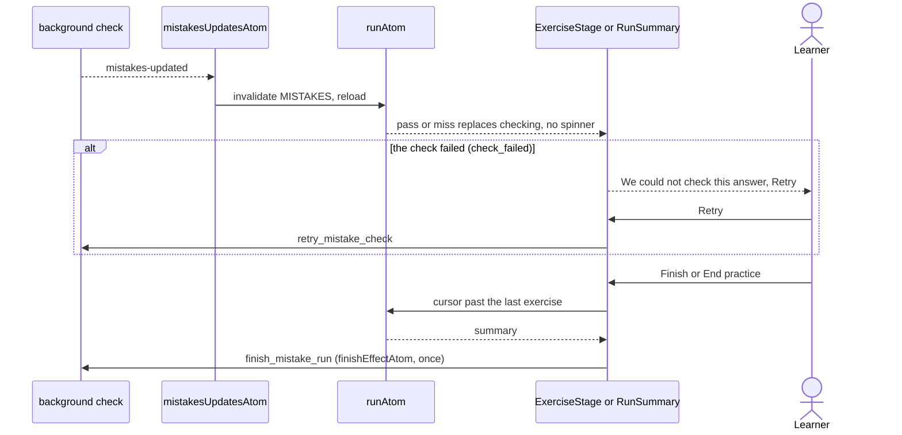

# Mistake practice run

A run is up to six exercises, one per mistake, planned by Rust (`PracticeService`). The frontend
shows the current exercise, sends answers and follows the results. `runAtom` reads the run and
reloads on the `MISTAKES` reactivity key, so a background result (`mistakes-updated`) fills in
without blocking the run. Which exercise is on screen is `cursorAtom`; without a cursor the run
resumes at the first exercise that has no answer.

## Start and resume

## Typed exercises (Fill the gaps, Fix it)

## Spoken exercises (Say it, Use it)

Recording, the live transcript and the local transcription are `core/answer-capture`, the same
path as Say it again on the wrap-up. The microphone button is disabled while a Talk conversation is
open or Eva is busy (`micBlockedReason` in the route). `spokenGuardAtom` cancels an unfinished
recording when the run screen closes.

## Checking results and the summary

