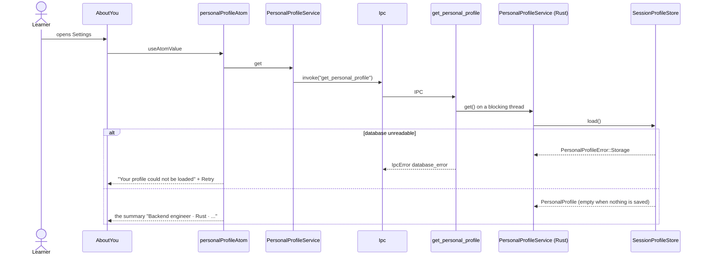
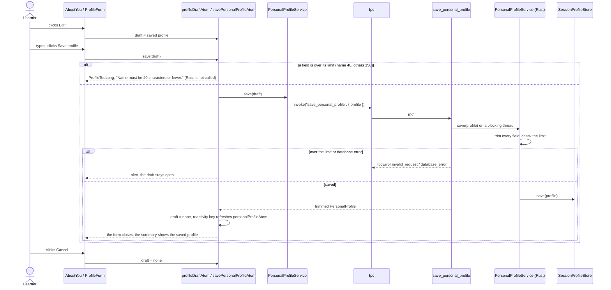

# About you

The Settings row "About you": a name (40 characters), role, stack, interests and goals (150 characters each, all optional).
Rust feeds the saved profile, without the name, into Eva's prompts and into the speech glossary; the
UI only reads and edits it. The Start greeting reads the trimmed name through `learnerNameAtom`.

## Read the profile

## Edit and save

