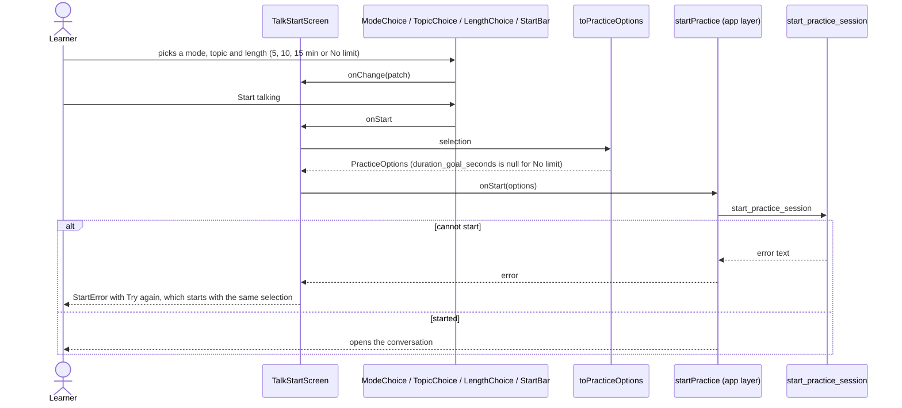
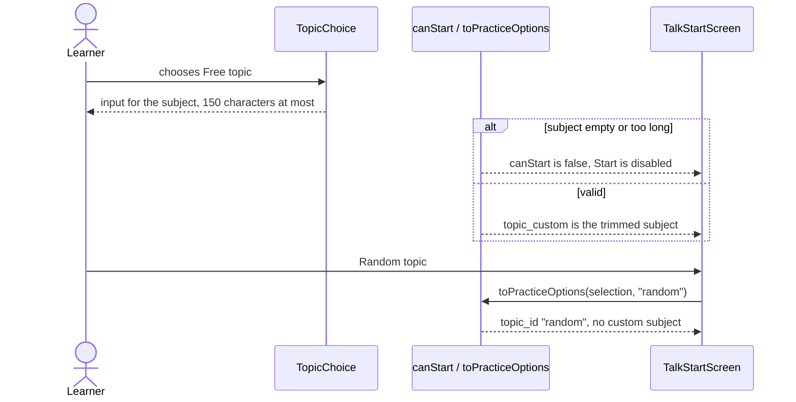

# Practice setup flow

The choices on the Talk start screen: how to practise, the topic, the suggested length, and the
buttons that start a conversation. The selection is ephemeral screen state owned by
`TalkStartScreen`; the feature supplies the controls and the rules that turn a selection into the
options Rust receives.

## Choose and start

## Free topic and Random topic

