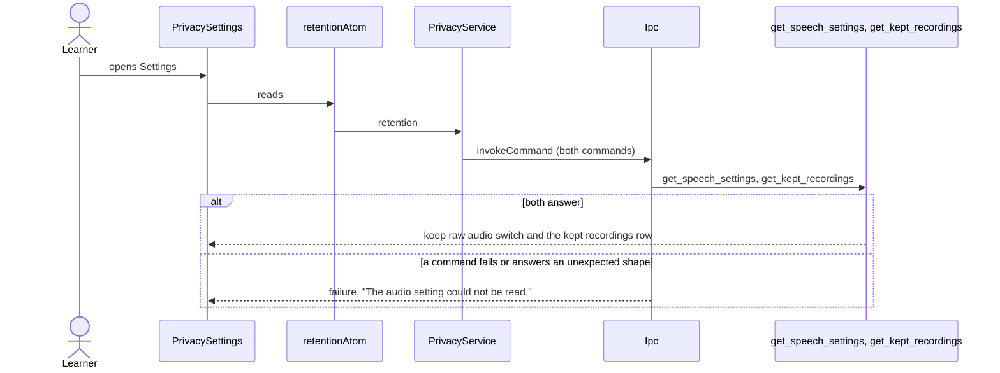
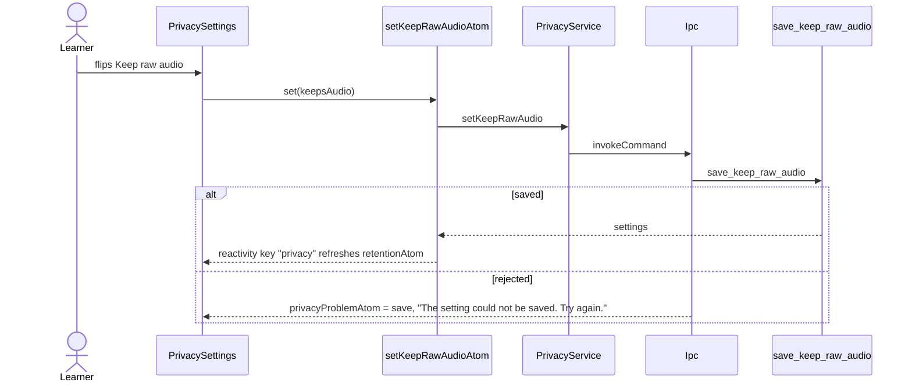
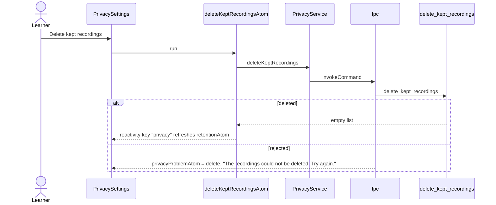

# Privacy flow

Settings › Privacy tells the learner what stays on the Mac and what is sent to the AI, lets them keep
raw audio after transcription, and deletes kept recordings. The commands belong to the audio context
in Rust, which has no generated bindings yet; the schemas in `schemas.ts` decode only the fields this
feature reads, and move to `core/ipc` when that context migrates.

## Open Settings

## Keep raw audio

## Delete kept recordings

