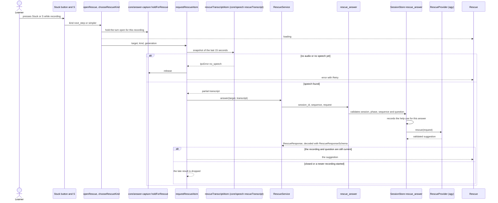
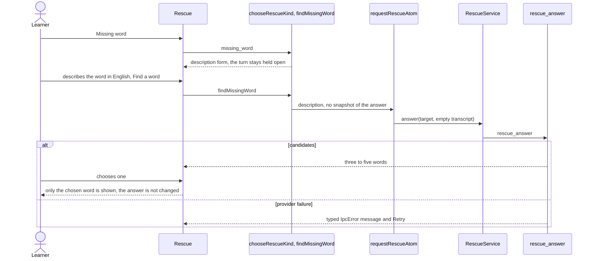
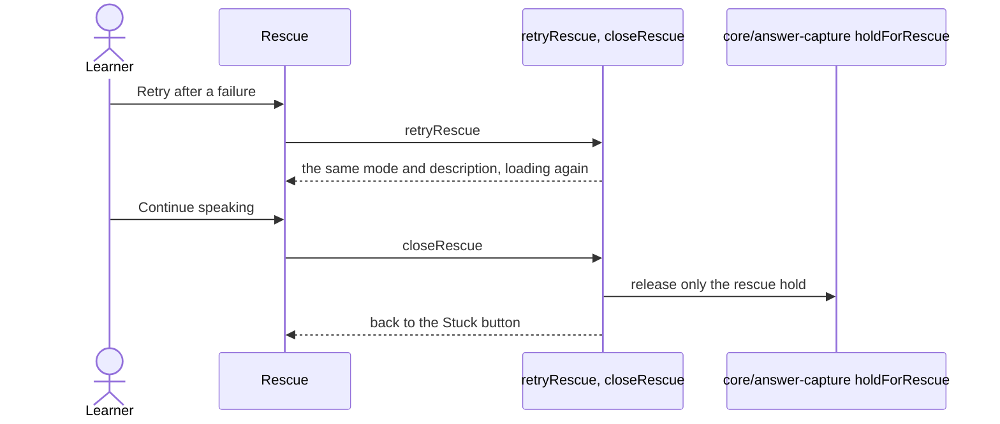

# Rescue flow

The "Stuck" control beside the microphone: while the learner is recording an answer, one press (or
`S`) asks for a next step, a simpler way to say it, or a missing word. The learner never leaves the
chat and the recording is never ended: rescue only holds the turn open while it works and releases
that hold when it is closed or fails. `screens/talk` decides when rescue is available and
mounts `Rescue` in the composer's rescue slot while the capture is recording.

## Ask for a next step or a simpler wording

The microphone keeps recording the whole time. Stop and cancel work while rescue is loading, and
the late result is dropped.

## Find a missing word

## Retry and close

A hold the learner set with "Keep listening" stays in effect. Leaving the recording, unmounting the
panel or starting a new recording drops any pending result and releases only the rescue hold.
