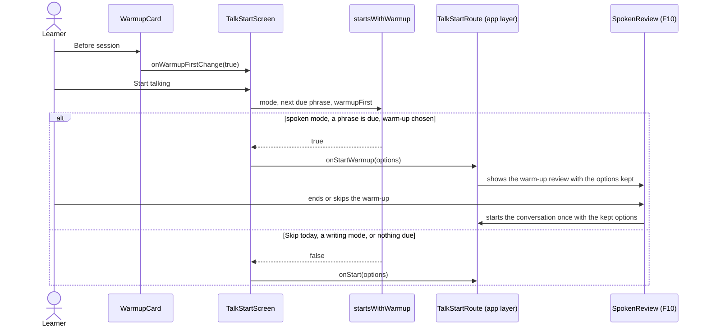
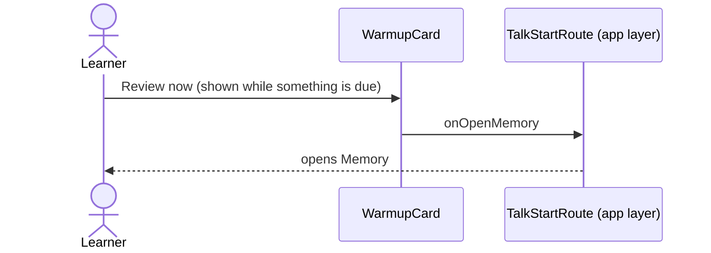

# Review warm-up flow

The "Say it again today" card: the next due phrase, a choice to warm up with a spoken review before
the conversation, and a shortcut to Memory. The review itself is the existing spoken review (F10);
this feature only decides whether to start it first.

## Warm up before the conversation

## Review now

