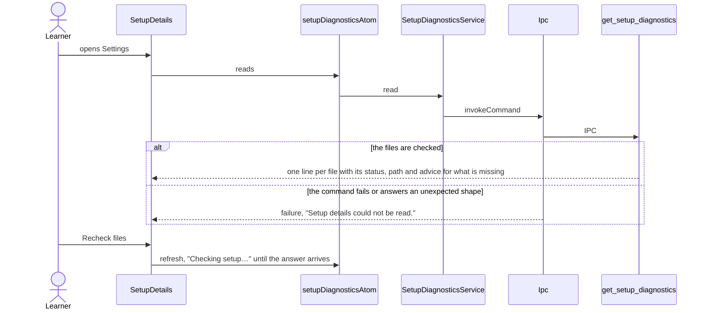
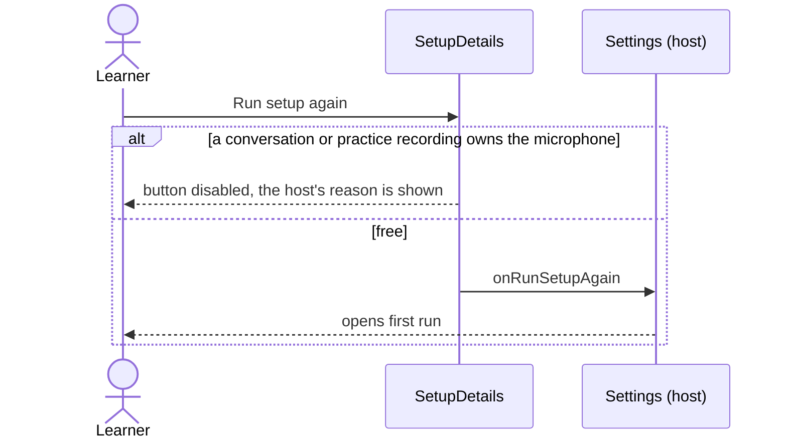

# Setup details flow

The Setup details panel at the end of Settings shows what the app found for local transcription and
coaching: the Whisper command, server and model, the `agy` command and the database path. It stays
closed until the learner needs it, and offers to run setup again. `get_setup_diagnostics` belongs to
the `setup` module in Rust, which has no context of its own yet: its types derive `ts_rs::TS` and
are decoded with `SetupDiagnosticsSchema` in `core/ipc`.

## Read and recheck

## Run setup again

