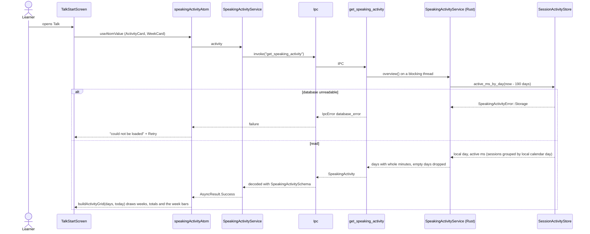
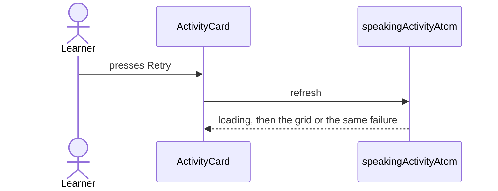

# Speaking activity flow

The 26-week grid and the "This week" card on the Talk start screen. Minutes come from the sessions
saved on this Mac (`active_duration_ms` per session, text-chat sessions left out); nothing leaves the
device. The copy is neutral: no streaks, no "you missed" wording, and an empty history shows an
invitation instead of zeros.

## Show the activity

## Retry

