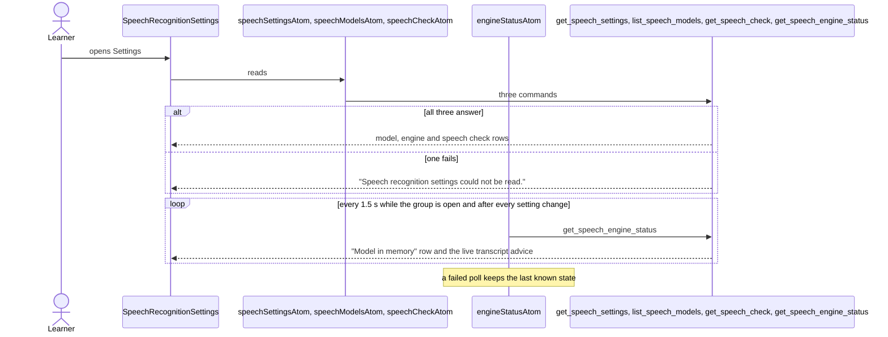
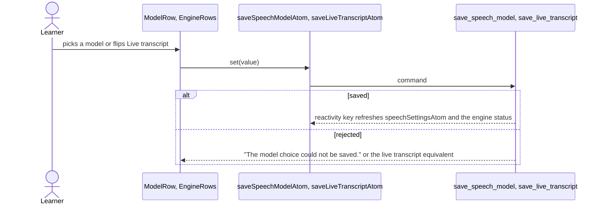
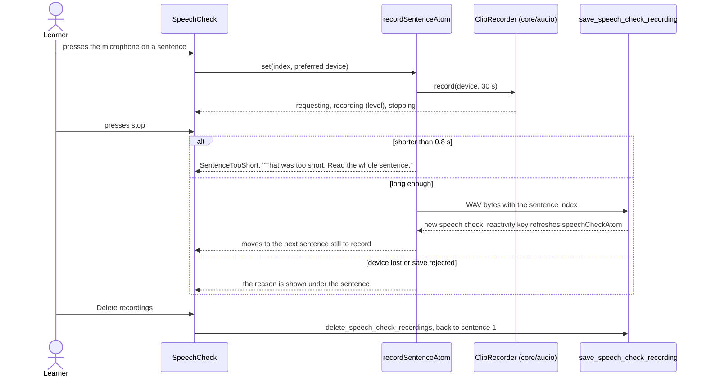
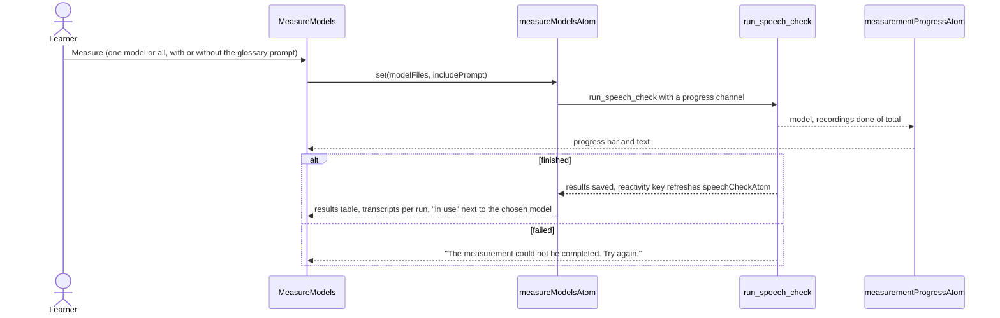

# Speech recognition settings flow

Settings › Speech recognition: which Whisper model transcribes the learner's answers, the speech
check that measures the installed models on the learner's own voice, the state of the model kept in
memory and the live transcript switch. The commands live in `core/speech`
(`SpeechRecognitionSettings`, `SpeechRecognition`); the sentence recordings use the `ClipRecorder`
of `core/audio`, so a recording is released as soon as it ends. The recordings of the speech check
are kept on the Mac only because the learner made them, until they are deleted. A test clip made in
Settings › Microphone is never saved.

## Open Settings

## Choose the model and the live transcript

## Record the speech check

## Measure the models

