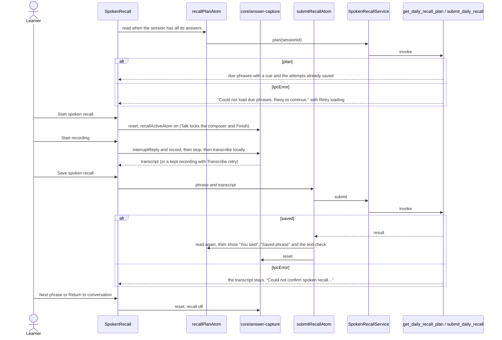

# Spoken recall

Once a voice session has all its answers, Talk offers an optional recall of a phrase saved in an
earlier session: Eva shows a cue, the learner says the phrase, and the transcript is saved as
evidence. It is a text check, never a pronunciation or mastery score. The microphone is the one in
`core/answer-capture`; this feature only decides what the recording is for.

## Offer, record and save

Leaving the recall resets the capture and never saves. A saved attempt is not duplicated by a retry.
