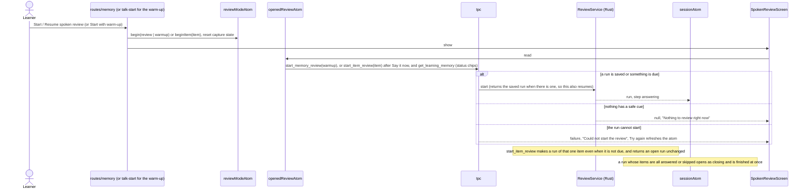
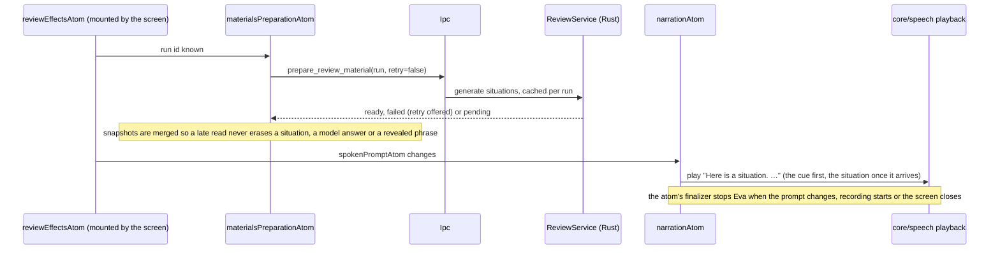
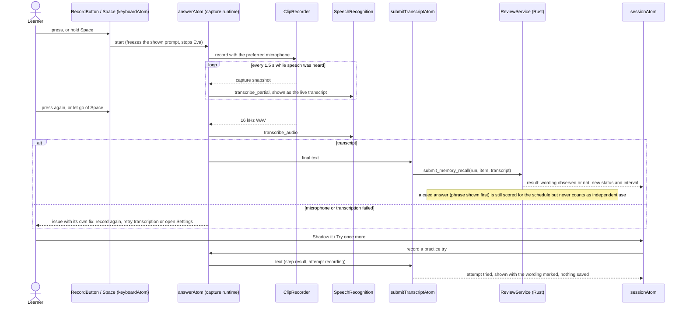
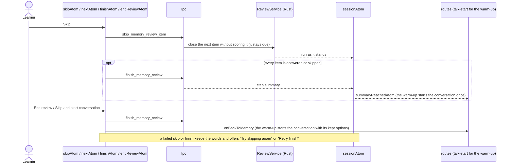

# Spoken review flow

The spoken review (F10): Eva gives a situation for each due phrase or mistake, the learner answers
aloud, and Rust decides whether the saved wording came up. The same screen is the warm-up before a
conversation. Rust owns the queue, the scoring and the schedule
([TECHNICAL_REQUIREMENTS §9](../../../docs/TECHNICAL_REQUIREMENTS.md)); this feature opens the run,
records the answer with a live transcript, shows the result and the way on.

Two runtimes: `learningMemoryRuntime` (IPC, reactivity key `LEARNING_MEMORY`) and `captureRuntime`
(the microphone and Whisper, sharing the `ClipRecorder` with `core/audio`). Session state is one
writable atom, `sessionAtom`, seeded from the opened run and changed by pure transitions in
`helpers/review-session`.

## Open the review

## Situations and Eva's voice

## Answer, result and shadowing

Esc cancels a recording (the clip scope closes, a late partial is dropped) or stops Eva. Skip and
End review cancel a recording first.

## Skip, next, finish

