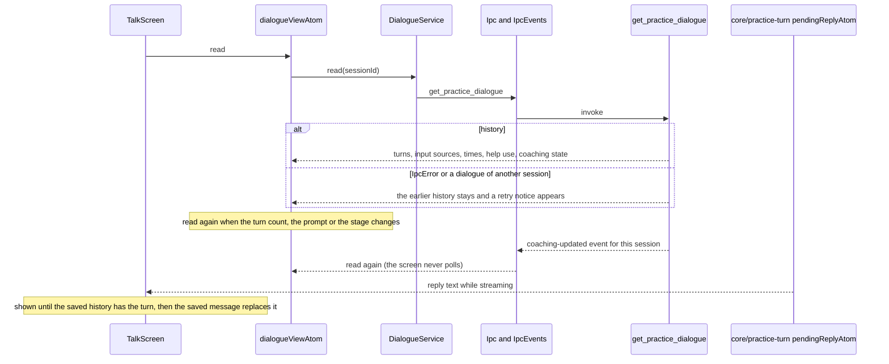
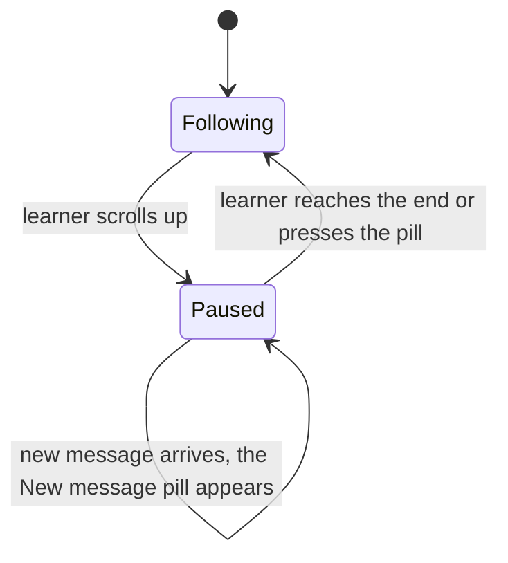

# Talk dialogue

Eva's and the learner's messages, with the reply that is still arriving, and the reads that keep
them current. Coaching notes are not here: the screen passes a render function for the note under
each answer.

## Following the newest message

The history is one surface with Eva: no frame, and a top fade mask lets older messages dissolve
under her. The view follows the newest message while a reply streams and while notes, notices or
answer help change the height of the content.

