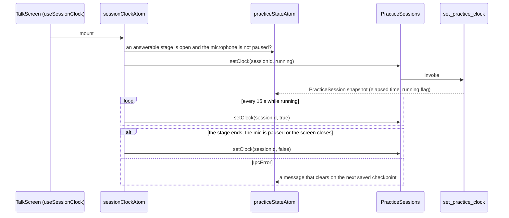
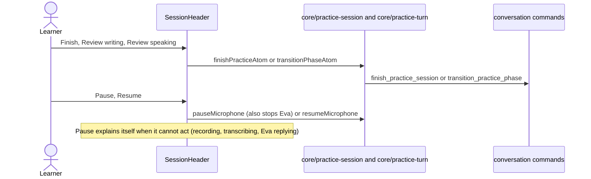

# Talk session

The header of the Talk screen and the session clock. The session itself (state, start, finish,
stage changes) lives in `core/practice-session`; this feature shows it and keeps the Rust clock
honest.

## Clock

## Header actions

